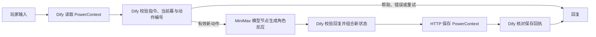

# 星际失物招领局技术说明

玩家在三幕委托中登记一种失物，选择个人找回或分享改装，最后领取纪念物。每次完成委托都形成可追溯的档案；新对话通过同一玩家代号读取该档案，让回访有明确的历史依据。

Dify Chatflow 包含实际读取、分支、LLM、校验、保存和答复节点。`flow_nodes/` 是这些代码节点的可读源码，YAML 中包含相同逻辑。模型只生成角色描写，失物、选择、幕数和纪念物由代码节点按规则确定。空回复、异常格式或超长输出不进入保存节点；模型失败和服务失败进入对应的回复分支。

配套 FastAPI 服务只管理状态与一致性，不调用模型，也不代替 Dify 执行游戏。它使用 PowerContext 1.4.1 的 `open_builtin_runtime`、Scope 和 `capture_working_note` 保存动作；`list_sources(limit=20,cursor=...)` 读取全部记录并重建最新修订。每名玩家有独立 Scope，事件包含输入、状态、普通回复、动作编号、修订、时间和前一来源。

项目锁使同一玩家的读取、查重、版本检查和保存顺序一致。同编号同输入返回原回执；同编号不同输入或过期修订返回冲突。Dify 按本次动作编号读取对应历史回执，避免把全部历史回复带入每个请求。保存成功以 SDK 回执为依据；遇到网络中断，界面要求沿用原编号重试。

部署固定 Dify 1.18.0、YAML 0.7.0、官方兼容插件0.0.73和 MiniMax-M2.5。Dify 使用官方 PostgreSQL 与 Redis；PowerContext 的独立 SQLite 数据保存游戏档案。模型密钥只配置在本地文件与 Dify 凭据管理中，适配器 token 绑定为秘密环境变量，导出 YAML 时排除秘密值。

实测覆盖两个玩家的不同结局、原生页面、后端重启后的新会话、干净应用重新导入，以及模型/状态/写入故障、动作重试和并发冲突。运行入口和样例见 README，原始证据见 `evidence/`。这是单机应用，玩家代号不承担身份认证，每玩家上限500个已保存动作。
