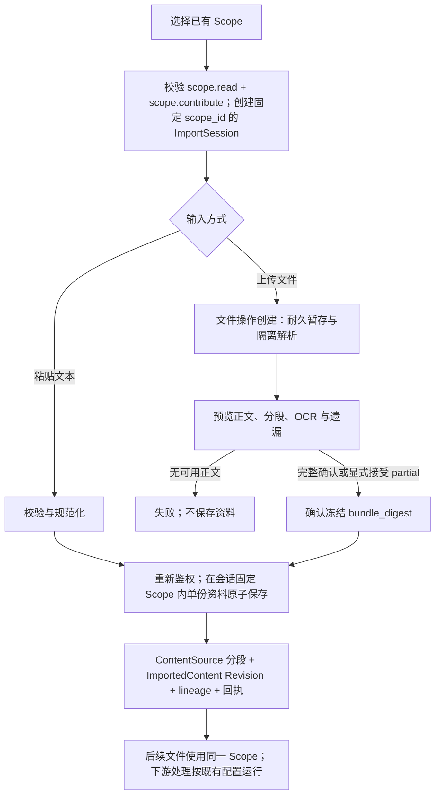
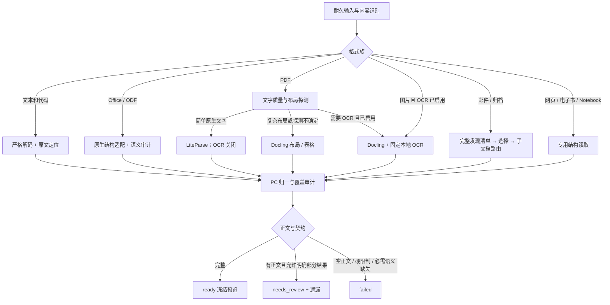
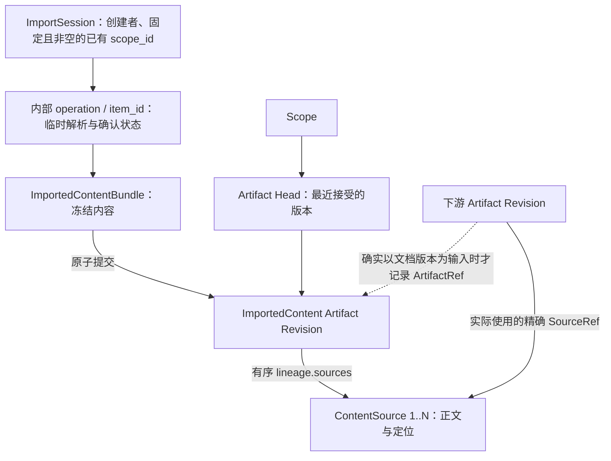
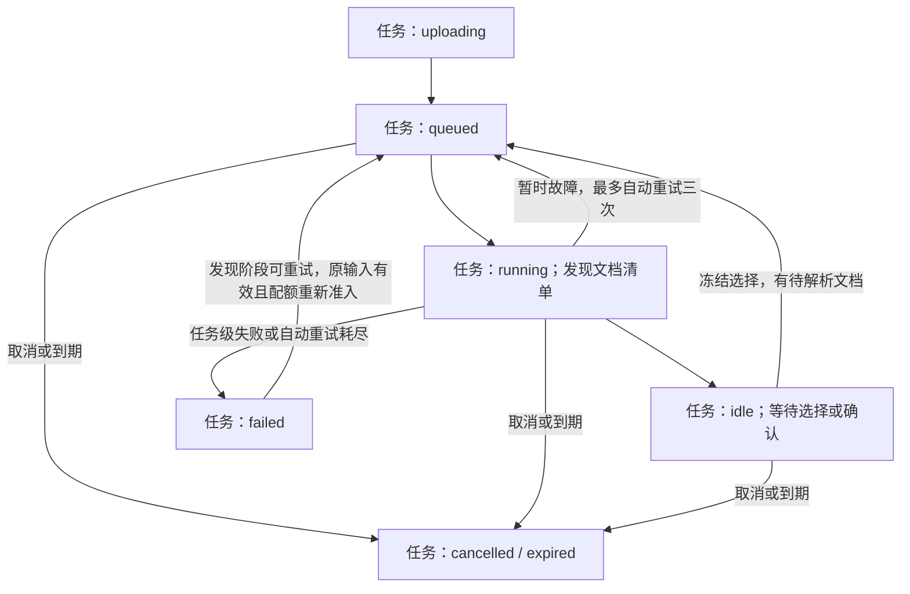
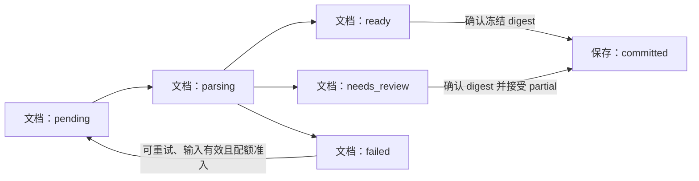

- Proposal Name: `text_material_import`
- Start Date: 2026-09-18
- Status: Proposed
- RFC PR: [oceanbase/powercontext#2073](https://github.com/oceanbase/powercontext/pull/2073)
- Design Baseline: [PowerContext master / cab054db（2026-10-19）](https://github.com/oceanbase/powercontext/tree/cab054dbf6d86e2311b079388e5158178257def2)
- Related RFCs: [Source Definition 与 Observation](https://github.com/oceanbase/powercontext/blob/cab054dbf6d86e2311b079388e5158178257def2/docs/zh/rfcs/1400_source_definition_and_observation_model.md)、[Source 与 Artifact REST API](https://github.com/oceanbase/powercontext/blob/cab054dbf6d86e2311b079388e5158178257def2/docs/zh/rfcs/1437_source_artifact_rest_api.md)、[Source 访问与生成准入](https://github.com/oceanbase/powercontext/blob/cab054dbf6d86e2311b079388e5158178257def2/docs/zh/rfcs/1458_artifact_generation_source_access.md)、[Scope 与 Source 发现](https://github.com/oceanbase/powercontext/blob/cab054dbf6d86e2311b079388e5158178257def2/docs/zh/rfcs/1502_scope_source_discovery.md)

# Summary

为 PowerContext 提供覆盖常见文本、办公文档、网页文件、表格、邮件、电子书、代码、图片与归档包的资料导入能力。用户必须选择已有且具有 scope.read + scope.contribute 权限的 Scope 后才能导入；粘贴文本、上传文件，或通过独立 OpenDAL worker 持续采集本地目录和对象存储。输入经过格式识别、编码处理、文档解析、可选 OCR 和有界分段，保存为不可变的 `content` Source，并保存为 `ImportedContent` Artifact（Family 标识 `importedcontent`），返回精确 Revision 回执。

采用“广泛格式支持、明确能力分级”的产品契约。轻量文本可直接保存；复杂文件通过隔离的解析 worker 处理；扫描件及图片需要显式启用 OCR。标准文档能力包覆盖 PDF、现代与传统 Office、OpenDocument、HTML、邮件和电子书等常见格式。部署必须公开实际可用的格式、解析器与限制，不能把文件类型识别成功或仅提取到元数据当作正文导入成功。

一份逻辑资料对应一个 ImportedContent Artifact，source_kind 固定为 content，统一使用现有文本证据类型，每次接受的新快照对应一个不可变 Revision，正文保存在其精确引用的 ContentSource 中。导入成功包含导入资料制品及证据保存，不承诺 Memory 等下游制品已经生成、原始二进制已归档或原文已建立检索索引。Head 表示 PowerContext 最近接受的版本，不代表外部文件的实时最新版；持续采集不传播删除。本文是拟新增契约，不代表功能已经发布。

已保存资料复用 Artifact 表、标准读取、Revision 与 lineage。导入写入由 ImportedContent Family 的专用操作负责；运行进度和私有预览只进入可清理的内部操作账本，不作为制品版本，也不新增 FileImportJob 业务资源。

# Motivation

项目资料不只存在于 TXT 和 Markdown，也广泛存在于 Word、PDF、Excel、PowerPoint、网页导出、邮件与扫描件。只扩展扩展名白名单无法完成导入：二进制格式需要解析，扫描页需要 OCR，表格需要保留行列关系，长文需要分段，解析不完整时还需要用户可见的错误与恢复方式。

仓库已有 ContentSource、Scope 权限、Source journal、文本投影、Source 集合与精确读取，以及 OpenDAL evaluation Connector 的 durable receipt 和 checkpoint CAS。这些能力构成保存与恢复基础，但不等于已经实现通用文件解析。

现有 OpenDAL evaluation 使用 `text-file-snapshot` 类型，worker 会注册 Definition manifest。它的 UTF-8 文件采集、权限要求和公开读取范围不直接构成本提案的文件支持合同。本提案复用内置 `content` Source，新增独立的资料导入应用服务与可选解析部署，不改变既有 Source Create/Capture 接口。

目标是让用户知道：当前部署能读取哪些格式、提取了哪些内容、遗漏了什么、材料保存到哪个 Scope，以及重复提交和失败时如何继续。

# Guide-level explanation

## 支持范围与能力分级

以下是本 RFC 的目标支持矩阵。A 为基础能力，B 为标准文档能力包，C 为可选 OCR 或扩展适配器。发布时每一项都需要实际样本验收；未安装依赖显示“未启用”，未完成适配显示“尚不支持”，不得统一标为支持。

| 类别 | 文件类型与常见扩展名 | 级别与提取内容 |
| --- | --- | --- |
| 纯文本与日志 | `.txt`、`.text`、`.log`；显式选择的无扩展名文本 | A；正文与行号 |
| Markdown 与轻量标记 | `.md`、`.markdown`、`.mdown`、`.rst`、`.adoc`、`.asciidoc`、`.org`、`.tex` | A；保留标记源码、段落与行号，不运行排版程序 |
| 数据与配置 | `.csv`、`.tsv`、`.json`、`.jsonl`、`.ndjson`、`.yaml`、`.yml`、`.toml`、`.ini`、`.cfg`、`.conf`、`.xml` | A；原文本及可验证的记录、行列定位，不执行对象构造或外部实体 |
| 源代码与构建文件 | `.py`、`.js`、`.ts`、`.jsx`、`.tsx`、`.java`、`.c`、`.h`、`.cpp`、`.hpp`、`.go`、`.rs`、`.sh`、`.bash`、`.zsh`、`.sql`、`.css`、`.scss`、`.vue`、`.svelte`、`.rb`、`.php`、`.swift`、`.kt`、`.kts`、`.scala`、`.r`、`.R`、`.lua`、`.pl`、`.ps1`、`.bat`、`.cmd`、`.proto`、`.graphql`、`.gql`、`.diff`、`.patch`；Dockerfile、Makefile、CMakeLists.txt | A；按文本保留，不运行、编译或安装依赖 |
| 字幕与记录 | `.srt`、`.vtt`、`.ass`、`.ssa`、`.ics`、`.vcf` | A；保留时间标记或原始字段，不调日历或通讯录 API |
| 网页与离线网页 | `.html`、`.htm`、`.xhtml`、`.mhtml`、`.mht` | B；静态 DOM 正文、标题、列表、表格与链接文字，不执行脚本或读取外链；不承诺浏览器计算后的可见性 |
| PDF | `.pdf` | B；文本层、页码及可提取表格。扫描或混合页使用 C 级 OCR |
| Word 与模板 | `.docx`、`.doc`、`.dot`、`.dotx`、`.docm`、`.dotm` | B；段落、标题、表格、脚注；宏不执行 |
| Excel 与模板 | `.xlsx`、`.xls`、`.xlsb`、`.xlt`、`.xltx`、`.xlsm`、`.xltm` | B 目标；工作表、单元格值、公式与已有缓存结果，保留范围位置；XLSB 的完整/仅值 profile 按第 1.4 节分别准入 |
| PowerPoint 与模板 | `.pptx`、`.ppt`、`.pps`、`.pot`、`.ppsx`、`.potx`、`.pptm`、`.ppsm`、`.potm` | B；幻灯片文字、表格和演讲者备注，保留页序 |
| 开放办公与富文本 | `.odt`、`.ott`、`.ods`、`.ots`、`.odp`、`.otp`、`.fodt`、`.fods`、`.fodp`、`.rtf` | B；文档、工作表或演示内容，对应定位规则一致 |
| 电子书 | `.epub`、`.fb2` | B；目录、章节与正文，不处理 DRM 加密内容 |
| 邮件与邮箱导出 | `.eml`、`.msg`、`.mbox` | B；主题、发件信息、正文；邮箱按邮件拆分，附件按显式选择处理 |
| Notebook | `.ipynb` | B；Markdown、代码单元和已保存文本输出，不执行代码或重新计算 |
| XML 文档与订阅 | `.rss`、`.atom`、`.opml`、`.xlf`、`.xliff`、`.tmx`、`.svg` | A 可保留源码；B 提供语义文本提取；SVG 仅提取文字节点，不执行或承诺理解图形 |
| 图片与扫描件 | `.png`、`.jpg`、`.jpeg`、`.tif`、`.tiff`、`.bmp`、`.webp`；静态 `.gif` | C；OCR 文字、图像/页序和可提供的定位，动画 GIF 不静默只取首帧 |
| 批量归档 | `.zip`、`.tar`、`.tar.gz`、`.tgz`、`.gz`、`.bz2`、`.xz` | B；安全展开，逐成员识别与导入，压缩包不是一种正文格式 |
| 扩展归档 | `.7z`、`.rar`、`.tar.bz2`、`.tbz2`、`.tar.xz`、`.txz` | C；需安装并验收对应解包适配器 |
| 专有或长尾文档 | `.pages`、`.numbers`、`.key`、`.wps`、`.et`、`.dps`、`.wpd`、`.hwp`、`.chm`、`.one`、`.pst`、`.mobi`、`.azw`、`.azw3`、`.heic`、`.heif` | C 扩展目标；按格式代际、正文提取能力、解码器及许可证分别准入，不承诺仅安装通用解析器就全部支持 |

A、B 是正式文件导入的交付范围；C 是同一扩展机制下按部署启用的能力。轻量安装可以只启用 A；标准文档安装必须打包并固定 B 所需依赖。支持 WPS 保存的 DOCX/XLSX/PPTX 不等于已经支持 WPS 专有的 WPS/ET/DPS。识别新一代 iWork 文件也不等于能提取其正文。

纯文本兜底不限于表中扩展名：用户可以显式选择“按纯文本读取”，通过编码、控制字符与大小校验后保存原文。目录采集默认仅扫描允许的类型，不能把整个目录内一切可解码文件自动导入；默认排除密钥、凭据文件、`.env`、版本控制目录、依赖目录与构建产物，可由用户明确选择其他规则。

首期不做音视频转写、任意数据库转储解析、可执行文件反编译、图形/图表推理，也不破解加密或 DRM。语雀、网页和 Git 链接抓取属于独立 Connector；导入本地 HTML 或语雀导出的 Markdown，不等于支持直接抓取链接。

## 用户流程

用户先选择已有且可贡献的 Scope，再进入文本或文件导入。全局入口必须明确选择目标；从某个 Scope 内进入时可预选当前 Scope，但仍须显示目标并校验权限。未选择有效目标时不能创建 ImportSession、提交粘贴文本或上传文件；没有可用 Scope 时提示先在现有 Scope 管理流程中准备目标。导入页面不提供创建 Scope 的表单或自动创建行为。

选定 Scope 后，页面展示当前部署支持的格式、实际限制和调用方权限。创建 ImportSession 时固定非空 scope_id 与创建者；同一会话的全部输入都属于该 Scope。改变目标必须创建新的会话，不能迁移正在解析或待确认的输入。

纯文本校验后可直接确认保存；文件先上传并解析，展示正文预览、页/表/幻灯片数量、分段数、OCR 使用情况及遗漏，再确认保存。确认时重新校验目标 Scope 及写入权限，在同一事务内保存单份资料的 Source、ImportedContent Revision、Head、lineage 和回执。失败、取消和只预览均不产生已提交资料。



普通导入只要求目标 Scope 的 `scope.read` + `scope.contribute`，不要求 `server.admin`。会话不能替代当前授权；上传后被撤权、目标不存在或不可写时，确认不得继续保存或自动改换目标。管理代操作遵循第 10 节。

第一次手动上传或粘贴默认“新建文档”；系统分配新的 artifact_id。更新现有文档必须从该文档进入“更新文件/文本”，明确指定 artifact_id 和预期 Head Revision。文件名相同、正文相似或字节摘要相同都不能自动合并文档；只可提示可能重复并让用户选择。重命名上传文件不影响明确指定的文档身份。

多份文件分别呈现待上传、解析中、待确认、已保存、已存在、需处理、版本冲突和结果待核实。文件名、已选择的目标 Scope、新建/更新文档意图始终可见。不用文件名推断既有文档身份；并发保存仍按同一 Scope 下的幂等、配额及 Head 并发规则处理。

例如，Word 提取成功、PDF 中含扫描页但未启用 OCR、Excel 的公式缺少缓存值时：Word 可以确认保存；PDF 必须说明受影响页，启用 OCR 后新尝试或显式接受部分文本；Excel 显示公式和“未保存计算结果”，不编造数值。不能把三份都显示为完整提取。

标准解析按照已声明范围保存，不能承诺完全还原二进制。界面使用“查看提取文本”；纯文本显示“查看原文”。图片、布局、图表和嵌入对象的处理范围与已知遗漏必须可见。解析完成与预览可见都不等于已经保存 Source 或 ImportedContent Revision。

## 格式特有行为

- **编码**：支持 UTF-8、带 BOM 的 UTF-16/UTF-32，以及显式指定的 GB18030、GBK、Big5、Windows-1252、ISO-8859-1。自动检测仅提供建议，除 BOM 和严格有效 UTF-8 外不静默采用猜测编码；先让用户确认，禁止用替换字符掩盖解码错误。
- **表格**：保留工作表名与单元格坐标，不只读取首张表。CSV/TSV 保留原始文本，可另外提供经校验的行列定位。公式不重算，不更新外链；默认纳入隐藏表、行、列并标记隐藏状态，用户可在预览前显式排除，此选择参与快照身份。
- **演示文稿**：按幻灯片顺序提取，备注单独标记。默认纳入隐藏幻灯片并标记；不把图片中的文字当作已读取，嵌入图像的文字需 OCR。
- **Word/开放文档**：标题、正文、表格、脚注按声明规则提取；修订采用已接受视图，批注默认不导入并报告数量，用户可选纳入且标明批注作者。解析器不能可靠提供这些视图时应报能力不足。
- **HTML/Notebook**：HTML 不运行 JavaScript、不抓取 CSS/图片/链接；Notebook 不执行单元。Notebook 默认包含已保存的文本输出，隐藏元数据、富媒体与 widget 不视为已导入正文。
- **PDF/OCR**：按页选择文本层或 OCR，避免同一区域重复叠加。空白页、图片页、解析失败页分别报告；低质量 OCR 输出是机器识别结果，不能称为精确转录。布局/页数信息不可得时报告未知，不能伪造完整性。
- **邮件与归档**：邮件正文中的引用历史保留，纯文本与 HTML 二选一并记录规则，避免重复。附件默认列出但不导入；用户选择后逐附件处理。归档默认展开第一层，嵌套包需显式开启且受深度限制；失败或未选成员在清单中保留。

## 保存与后续处理

一份逻辑文档对应一个 `ImportedContent` Artifact，接受的快照对应 Revision；长文按结构分成多个不可变 ContentSource。单份文档的全部分段、Revision、Head、lineage、待处理登记和回执在同一事务提交。事务仅写入会话固定的已有 Scope，不创建 Scope 或初始化权限。跨文件、归档成员和邮件间允许部分成功。

成功表示导入资料制品和正文证据已可靠保存，不需要 LLM 或 Candidate 审批。Memory 等既有处理器是否消费这些 Source、处理多少、产生什么候选或制品，继续由原有配置和领域契约决定。importedcontent Family 不默认注册自动生成处理器，不能因称为 Artifact 就触发递归生成。

历史 Revision 与其 Source 保留，不因 Head 变化而覆盖。资料详情可以显示版本历史，以及按精确 SourceRef 或真实 ArtifactRef 反查的下游引用；不在导入时预填未来“关联制品列表”。一次 consumer window 不保证处理全部分段，不虚构全文理解完成状态。

原文件仅用于解析暂存，默认不是长期文件档案。保存后保留提取文本、文件摘要、解析版本、定位及遗漏；下载原始二进制和长期存档不属于本期承诺。

## 持续采集与 Dashboard

OpenDAL worker 在存储附近运行，持有读取凭据并把文件字节提交给导入服务；Server 不通过用户提供的路径或 URL 读取任意文件。文本与复杂文件使用同一份能力矩阵。周期执行仍由外部调度器负责。

Dashboard 保持既有 Tabler、Jinja2、HTMX、中英文及明暗主题。写入口由 `POWERCONTEXT_SERVER_DASHBOARD_TEXT_IMPORT_ENABLED` 显式开启，默认关闭，继续满足现有静态 Bearer 和 enforced access 前置条件。文件解析另要求解析服务可用，关闭该服务不影响已保存资料阅读。

页面结构为“选择已有 Scope → 资料列表 → 选择文本/文件 → 解析预览与问题清单 → 确认保存 → 精确阅读”。切换 Scope 不改变正在运行任务的归属，也不自动提交未完成输入。关闭浏览器后可从任务记录恢复已接受的文件解析；未上传完的本地文件需重新选择。

# Reference-level explanation

## 1. 架构

入口、解析和保存之间的责任边界见“用户流程”图。文件通过 ImportedContent Family 的文件操作创建接口产生冻结的 ImportedContentBundle，执行过程由内部操作账本和隔离 worker 承担；用户确认或 worker 按显式策略接受后，ContentImportApplication 才执行单文档原子提交。制品处理仍沿用已有配置与进度机制。

文件获取、解析、文本保存与制品生成是四个边界。Core 不导入任意用户指定 parser，不运行 Office 宏，不执行代码。正式部署提供独立 parser worker；轻量文本路径不要求文档解析依赖。

### 1.1 解析器职责与固定选型

采用“原生结构优先、PDF 按布局分流、OCR 显式开启”的组合方案。PowerContext 实现格式识别、结构审计、ImportedContentBundle 归一、证据分段、任务与保存；复用解析库完成格式解码、布局和 OCR，不自研通用 OCR 模型。下述 profile 名是拟新增的产品契约，不是上游已经提供的接口或已完成实现。

| 组件 | 本 RFC 中的固定职责 | 不承担的职责 |
| --- | --- | --- |
| 原生文本/容器适配器 | 严格解码，CSV/JSON/XML 等定位，OOXML/ODF 结构审计，邮件/归档发现 | 不执行内容，不用 LLM 重写正文 |
| LiteParse | 简单文本 PDF 的轻量提取、页几何与复杂度信号；标准路径关闭其内置 OCR | 不统一把 Excel/Word/PPT 转 PDF，不用其 Markdown 清理结果代替全部证据 |
| Docling | 复杂布局 PDF、现代 Word/开放文档的结构提取；启用 OCR 时使用指定本地引擎 | 不负责资料身份、提交或索引，不直接使用检索 chunk 作为 Source |
| openpyxl / Apache POI | 工作簿的原生单元格、公式与已有值；POI 同时用于传统 Office 结构适配 | 不计算公式，不刷新数据连接，不将工作簿打印成 PDF |
| python-pptx + OOXML 审计 | 现代演示的文字、表格、备注与隐藏状态 | 不执行宏，不将演示动画和图表理解混入正文 |
| Apache Tika | 传统文档、RTF、MSG 和已准入长尾格式的受控格式解析 | 不作为无限制自动探测/递归/云 OCR 兜底，不把 metadata 视为正文 |
| 本地 RapidOCR | 通过 Docling 处理扫描 PDF/图像，首个目标语言集为简体中文与英文 | 不自动外发；繁体、其他语言与手写须独立验收 |
| MinerU / DeepDoc / LlamaParse | C 级、独立启用的复杂文档替代 profile；LlamaParse 属外部或企业自托管服务 | 不加入标准 profile 的隐式 fallback 链 |
| LlamaIndex | 后续可选 Reader/检索变换参考，索引阶段按需使用 | 不接管导入事务、版本和 Source；不使用默认 Reader 的跳过错误行为 |

组件取舍基于 [RAGFlow 调研](https://yuque.antfin.com/obopensrc/knowledge_sharing/lmziuic5tzhgny8c)、[Docling/MinerU 调研](https://yuque.antfin.com/obopensrc/knowledge_sharing/rcga2z7gr8r3vwbo)与[LiteParse/LlamaIndex 调研](https://yuque.antfin.com/obopensrc/knowledge_sharing/yl6nfo4yugep4n6a)。这是拟实施的选型，不是解析质量排名。首轮适配基线采用已调研的 LiteParse Python 2.14.7、Docling 2.129.0；MinerU 4.0.5 仅作可选适配验证基线。发布镜像还必须锁定其传递依赖、模型和转换工具，不能使用 latest。其他组件在实施时固定通过样本与安全检查的具体版本及镜像摘要。

### 1.2 A 级：原生文本、标记与结构定位

以下各组覆盖支持矩阵中该类的全部扩展名；同类不同后缀不产生不同正文规则。A 路径保存解码后的原始文本，结构解析只增加可验证定位，默认不改写正文。

| 输入 | 默认 profile 与具体方式 | 提取/定位与失败规则 |
| --- | --- | --- |
| TXT、TEXT、LOG、显式无扩展名文本 | `text-native-v1`：Python 严格 codecs 解码 | 保留换行、缩进、字符和行号；编码不确定要求确认 |
| Markdown、RST、AsciiDoc、Org、TeX | `markup-source-v1`：同一文本解码器；Markdown 可用 markdown-it-py 辅助识别块 | 正文保存标记源码；不渲染 TeX，不执行 include、插件或远程资源 |
| 全部代码、构建文件、diff/patch | `code-source-v1`：原文与行索引 | 不编译，不运行 formatter，不因语言识别失败丢失正文 |
| CSV、TSV | `delimited-text-v1`：原文 + Python csv 读取器 | 固定分隔符、引号和编码；记录逻辑行、字段及原文范围；允许跨物理行字段，分隔符歧义要求确认 |
| JSON、JSONL、NDJSON | `json-source-v1`：有界 JSON 语法扫描、逐记录解析 | 保留原文及重复键顺序，定位记录与字段出现序号；不将 dict 序列化结果替换原文 |
| YAML/YML、TOML、INI/CFG/CONF | `config-source-v1`：保留源码；PyYAML SafeLoader、tomllib、禁用插值的 ConfigParser 仅作可选结构校验 | YAML 限制别名和深度，不构造任意对象；键路径无法唯一定位时只提供原文行号 |
| XML | `xml-source-v1`：禁用 DTD/实体/网络的 XML 读取器 | 保留源码；节点路径、命名空间和可提供的行号，不执行 XInclude/XSLT |
| SRT、VTT、ASS、SSA | `subtitle-source-v1`：文本 + 有界字幕时间标记扫描 | 保留全部原字段，增加时间范围；不重新排序或翻译 |
| ICS、VCF | `record-source-v1`：保留文本并识别折行和记录边界 | 原文行与逻辑记录区分，不调用日历/通讯录 API |
| RSS、Atom、OPML、XLF/XLIFF、TMX、SVG 的源码模式 | `xml-source-v1` | 保存源码；语义提取另走 B profile，不能静默切换 |

辅助结构校验失败时，返回原文可用、结构定位不可用的明确警告；如果用户选择的是要求结构完整的 profile，则失败或 needs_review，不能改成源码模式冒充成功。A 路径的原文字节/字符保真不以结构解析成功为前提，但仍必须通过编码、控制字符和大小校验。

### 1.3 PDF：文字、布局与 OCR 路由

默认 `pdf-standard-v1` 是固定版本的复合 profile：先用 LiteParse 做有界页面探测；全文文字层可用且无复杂布局信号时采用 LiteParse 的结构化 text_items；出现多栏、疑似复杂表格、顺序异常或探测不确定时，采用 Docling 标准布局/表格路径。两者均默认关闭 OCR 和生成式增强，路由判断及阈值作为 profile 的版本化配置，通过样本集固定。

| PDF 情况 | 解析方式 | 完整性规则 |
| --- | --- | --- |
| 简单文字层、正常阅读顺序 | LiteParse JSON/结构化输出 → PC 有序块归一 | 保留物理页序、显示页标签、页尺寸及可用 bbox；不依赖默认去页眉页脚的 Markdown |
| 多栏、复杂表格、目录/脚注布局 | Docling 标准 pipeline，读取 DoclingDocument 和 provenance | 结构节点与阅读顺序归一；表格保留行列/合并关系和原始页定位，不能只保存渲染 Markdown |
| 扫描、混合、乱码文字层，`ocr_mode=off` | 仅提取可用原生文字，明确标出需要 OCR 的页/区域 | 有正文则 needs_review；只有元数据或无正文则失败，返回 ocr_required/no_extractable_text |
| 扫描、混合，`ocr_mode=auto` | Docling + 固定本地 RapidOCR，对需要的页/区域识别 | 合并时按区域去重；记录实际 OCR、引擎、语言和遗漏，不能用 needs_ocr 代替执行记录 |
| `ocr_mode=force` | Docling + 同一 OCR 引擎，按明确范围强制识别 | 以配置的识别结果为准，不与原生文本双份叠加；强制策略和可能质量变化在预览中显示 |
| 公式、手写、复杂图表仍不可可靠提取 | 原路径保留可用文字和位置，报告不能识别的对象 | 不能根据图像猜正文；可由用户新建尝试选择 C 级 MinerU/DeepDoc/LlamaParse profile |

`needs_ocr` 与 layout complexity 分开使用；没有 OCR 需求不表示布局简单。源页数、请求范围、返回页、空白页、失败页分别统计。不能将引擎 max_pages 截断解释为完整文档；用户未请求部分范围而触发硬上限时，沿用本 RFC 的超限拒绝规则。

首期按整份 PDF 确定一个正文解析后端；该后端内部可以按页使用原生文字或 OCR。不同 PDF 引擎不逐页拼接结果，避免跨页表格、阅读顺序与坐标不一致。复杂度探测结果可暂存复用，但不是跨引擎通用的中间结果。跨页表格无法可靠合并时保留分表及页范围，并报告关系未确定。

PDF 默认纳入可提取的页眉页脚并标为相应块；水印、批注、表单和图片文字的纳入/排除必须在 profile 中声明。未开启某类内容不能把数量记为零；已检测存在却未处理的内容列入 omissions。文本位置是出处描述，首期不承诺原始 PDF 永久在线预览。

### 1.4 B 级：Office 与开放办公格式

原生文档结构优先于打印布局；现代 Office 不默认转 PDF。模板和宏变体通过 MIME、容器内容类型和关系识别；适配器读取原始容器，不能仅改后缀绕过库的限制。

| 输入 | 默认 profile / 后端 | 必须保留与准入条件 |
| --- | --- | --- |
| DOCX、DOTX、DOCM、DOTM | `word-ooxml-v1`：Docling DOCX 结构转换 + PC OOXML 审计/补充读取 | 标题、正文、表格、脚注/尾注、修订视图、选中批注；docm/dotm 宏不加载执行；后端不接受的变体由受控 OOXML 适配器读取，未验收则 planned |
| DOC、DOT | `word-legacy-v1`：受控 Tika OfficeParser / POI HWPF，适配器补齐结构审计 | 不以一段纯文本证明脚注、修订和批注完整；无法可靠提供用户选择的视图时 capability_insufficient，禁止静默转 PDF |
| XLSX、XLTX、XLSM、XLTM | `sheet-ooxml-v1`：openpyxl + OOXML 原始单元格/关系读取 | Sheet、A1 坐标、数据类型、合并范围、隐藏状态、公式及已有缓存值；宏只作为被排除对象计数 |
| XLS、XLT | `sheet-biff-v1`：POI HSSF 原生读取 | 读取公式 token 的可用表达及存储的缓存值，不调用 FormulaEvaluator；老 BIFF 代际逐项验收，不满足时拒绝该代际 |
| XLSB | `sheet-xlsb-v1`：POI XSSFB 事件读取 + 明确的结构适配 | 默认“公式与值”契约必须通过验收才 available；只读缓存值的能力另列 profile，见下文，不冒充完整工作簿 |
| PPTX、PPSX、POTX、PPTM、PPSM、POTM | `slides-ooxml-v1`：python-pptx + 原始 OOXML 关系/节点审计 | 幻灯片顺序、文字框/组内文字、表格、备注、隐藏页；修复模板入口需适配器明确处理，不修改原文件 |
| PPT、PPS、POT | `slides-legacy-v1`：POI HSLF，复用 Java worker | 原生幻灯片与备注；不能仅用 Tika 合并正文后推算页界；未知 OLE/图形对象列入遗漏 |
| ODT、OTT、FODT | `odf-text-v1`：Docling + PC 安全 ODF XML 结构读取 | 对打包/Flat XML、标题、表格、注释和修订视图逐项校验；不足时不降为“所有 XML 文本” |
| ODS、OTS、FODS | `odf-sheet-v1`：PC 安全 ODF XML 原生适配器 | 表/行列、重复计数、合并与覆盖单元格、隐藏、公式和已存值；展开重复行列前计算预算 |
| ODP、OTP、FODP | `odf-slides-v1`：PC 安全 ODF XML 原生适配器 | draw:page 顺序、文字框、表格、备注及显示状态；无稳定对象定位时明确降低定位能力 |
| RTF | `rtf-native-v1`：Tika RTFParser 的结构化输出 + PC 归一 | 正文/段落及可提供表格、脚注；嵌入对象只列清单，不执行；不支持的控制组报告 |

**Word 的补充读取是适配器工作，不是 Docling/python-docx 已完整实现的保证。** OOXML 按关系图审计段落、表格、脚注/尾注、批注和修订节点；“已接受视图”包含插入/moveTo、排除删除/moveFrom，对属性修订和不支持的复杂变更不能猜测。无法可靠生成该视图时拒绝该 profile；用户若选其他视图需新尝试和明确能力支持。补充文本按原锚点入序，不能在正文末尾随意追加造成重复和错序。

**工作簿不重算。** XLSX 读取公式视图与 data_only 缓存视图时使用同一输入摘要及 Sheet/坐标对齐；必要时直接读取 `<f>`、`<v>`，区分真实空单元格、空字符串缓存和未保存缓存。公式、缓存值、类型与格式化显示是不同字段；外部引用只保留字符串，不访问资源。损坏的 shared/array formula 或动态数据结构报告受影响范围。

**XLSB 是已知准入风险。** POI 的公开 XSSFB 文档明确存在公式表达提取限制，不能因支持读取 XLSB 就承诺公式保真。默认 `sheet-xlsb-v1` 在完整契约未实现前保持 planned；可单独发布显式选择的 `sheet-xlsb-values-v1`，仅在 Sheet/单元格/隐藏范围可核验时导入已有值，始终 needs_review，明确“公式表达未提取”，由用户 accept_partial。范围无法核验或无正文时仍失败。该有限 profile 不算完成 B 级完整 XLSB 交付，也不能被自动采集的 complete-only 接受。[POI XLSB 限制](https://poi.apache.org/apidocs/5.0/org/apache/poi/xssf/extractor/XSSFBEventBasedExcelExtractor.html)

**LibreOffice 不在标准工作簿路径中。** 格式转换可能改变公式缓存、字体、分页和对象语义；因此不通过 LibreOffice 把 XLS/XLSB/ODS 转 XLSX/PDF 来规避“不重算”契约。文档类如确需转换，仅在单独发布、经过无外链/宏/计算副作用验收的扩展 profile 中启用；首期不依赖该方式完成表格结构承诺。

### 1.5 B 级：网页、电子书、邮件、Notebook 与归档

| 输入 | 默认 profile / 具体方式 | 正文及成员规则 |
| --- | --- | --- |
| HTML、HTM、XHTML | `html-dom-v1`：html5lib 解析 + PC DOM 文本/结构遍历；XHTML 安全 XML | 标题、段落、列表、表格和链接文字；排除 script/style/template 及明确隐藏节点，不执行 CSS/JS；不能声称复现浏览器计算后的可见性 |
| MHTML、MHT | `mhtml-native-v1`：Python email MIME 解析 → 选定 root HTML → html-dom | 根据根部件信息与 content-location 识别正文；无法确定根文档时报告错误；内嵌资源只列清单，禁止 URL 回源 |
| EPUB | `epub-spine-v1`：安全 ZIP → container/OPF → spine 顺序 → html-dom | EPUB 阅读顺序、章节、导航与文本；不按 ZIP 文件名排序；脚本、远程资源、DRM 不处理 |
| FB2 | `fb2-native-v1`：安全 XML → body/section/notes | 正文、章节、脚注引用；二进制图片不作为正文 |
| EML | `mail-rfc822-v1`：Python email BytesParser | 解码 header/MIME；multipart/alternative 优先可用 text/plain，否则 html-dom；CID 图片/附件列清单，不拼接双份正文 |
| MBOX | `mailbox-mbox-v1`：有界 mbox 迭代 + mail-rfc822 | 先发现邮件成员再按选择解析；保留消息序号、可用 Message-ID 和容器链，重复 Message-ID 不当作唯一键 |
| MSG | `mail-msg-v1`：Tika/POI HSMF 受控读取 | 提取主题、发件信息与正文；HTML 走 html-dom，RTF 正文走 rtf-native；完整附件发现不得由自动递归文本合并代替 |
| IPYNB | `notebook-native-v1`：有界 JSON + nbformat 校验 | 原序 Markdown/code/raw cell；默认已保存 text/plain、stdout/stderr 和文字错误输出；HTML 输出显式净化/纳入，富媒体/widget 列为排除 |
| RSS、Atom、OPML | `feed-xml-v1`：安全 XML 的格式专用映射 | feed/channel/entry/item/outline 的标题、正文与链接文字，保留节点路径，不抓正文链接 |
| XLF、XLIFF、TMX | `translation-xml-v1`：按具体 schema 读取 source/target/segment | 单元 ID、语言与原/译文分别标记，不能把两种语言拼成重复正文；不同 XLIFF 代际独立验收 |
| SVG 语义模式 | `svg-text-v1`：安全 XML 提取 text/tspan/title/desc | 不光栅化运行脚本；path 轮廓文字和图形含义不承诺，图像资源不回源 |
| ZIP、TAR、TAR.GZ/TGZ | `archive-native-v1`：Python zipfile/tarfile 有界流式读取 | 先列完整成员，选择后递归分发；不调用 extractall 写任意路径；拒绝链接/设备/重复路径 |
| GZ、BZ2、XZ | `compressed-stream-v1`：对应标准库解压器 | 单流解压后重新识别，是 TAR 则进入归档发现，否则是一份子文档；不能将每个压缩流都称为多文件归档 |

Python MIME/mailbox 提供基础读取，PowerContext 仍负责资源上限、结构缺陷、选择与稳定来源规则；库返回对象不代表容器清单完整。[email parser](https://docs.python.org/3/library/email.parser.html)、[mailbox](https://docs.python.org/3/library/mailbox.html)

Tika 只调用注册的格式解析器，关闭自动 OCR、网络和不受控 embedded recursion；附件/嵌入资源通过受控回调参与发现，不能被解析器偷偷加入正文。对于已检测但无法列举完整附件的输入，discovery 失败，不发布可选择的“完整”成员清单。普通文档中的未选嵌入对象则按已声明的排除规则报告。

### 1.6 C 级：OCR、替代引擎与长尾格式

| 输入或需求 | 指定扩展方式 | 启用条件 / 限制 |
| --- | --- | --- |
| PNG/JPEG/BMP/WebP、静态 GIF | `image-ocr-v1`：Pillow 解码、方向归一 → Docling + 本地 RapidOCR | OCR 显式开启；记录原始与旋转后坐标映射；不识别图表语义 |
| TIFF/TIF 多页 | `image-multipage-ocr-v1`：有界枚举全部图像页 → 同一 OCR profile | 每页计数、像素和 OCR 预算；失败页明确报告；不能只读首帧 |
| 动画 GIF / 多帧变体 | 默认拒绝该变体 | 仅在独立多帧 profile 完成帧语义与重复文字验收后开放 |
| HEIC/HEIF | `heif-ocr-v1`：pillow-heif/libheif 解码 → image OCR | 区分主图、缩略图、辅助图和序列，固定选择范围；只有 metadata 不可用 |
| 复杂 PDF/扫描件替代 | `pdf-mineru-v1` / `pdf-deepdoc-v1` | 分别直接适配 MinerU 结构协议或隔离封装 DeepDoc；固定 tier/模型；不通过整套 RAGFlow 间接转接 |
| 可选服务解析 | `document-llamaparse-v1` | 部署显式启用、用户选择并看到数据流向；固定 API/版本/tier，下载结果后冻结；不作为本地解析失败后的自动外发 |
| 7Z / RAR | `archive-libarchive-v1`：libarchive-c 的已验收解码能力 | 先安全列举再有界读取；具体压缩方法/格式代际单独准入；加密仍拒绝 |
| TAR.BZ2/TBZ2、TAR.XZ/TXZ | `archive-native-extra-v1`：标准库解压 + tarfile | 复用归档限制；保留 C 级部署开关，不因依赖存在自动打开 |
| Pages | `iwork-pages-v1`：Docling format-iwork 路径 | 按容器代际验收正文/结构，未通过保持 planned；不使用 Tika 新代际 metadata 代替正文 |
| Numbers / Keynote | `iwork-legacy-v1`：仅对 Tika 能提取正文且结构验收通过的旧代际启用 | 新代际默认 planned；Numbers 需满足工作表要求，Keynote 需满足演示要求，否则要求用户导出 XLSX/PPTX |
| WPS/ET/DPS 专有格式 | `wps-native-v1` 保留受控扩展接口，首期 planned | 明确要求用户导出 DOCX/XLSX/PPTX；不以改扩展名、通用识别或自动打印成 PDF 宣称原生支持 |
| WPD | `wordperfect-tika-v1`：Tika WordPerfectParser | 仅准入已验收格式代际和内容范围 |
| HWP | `hwp-tika-v1`：Tika HwpV5Parser | HWP v5 单独验收，不扩展解释为所有 HWP/HWPX |
| CHM | `chm-tika-v1`：受控 Tika ChmParser 发现 HTML 成员 → html-dom | 禁止执行帮助程序，章节顺序可验证后开放 |
| ONE | `onenote-tika-v1`：Tika OneNoteParser | 需验证页/节边界和嵌入对象；不将完整笔记同步能力算入文件导入 |
| PST | `pst-tika-v1`：Tika OutlookPSTParser 的受控成员发现 → 邮件适配器 | 完整文件夹/邮件/附件清单及稳定来源规则通过后开放，不自动关联邮箱账号 |
| MOBI/AZW/AZW3 | `ebook-calibre-v1`：隔离的 calibre ebook-convert → EPUB → epub-spine | 仅无 DRM、已验收变体；固定转换版本与选项，标记转换损失，默认不启用 |

长尾方案依据 [Tika 格式说明](https://tika.apache.org/docs/4.0.x/formats.html)、[Docling 格式表](https://docling-project.github.io/docling/usage/supported_formats/)、[pillow-heif](https://pillow-heif.readthedocs.io/en/stable/pillow-plugin.html)与[calibre 转换接口](https://manual.calibre-ebook.com/generated/en/ebook-convert.html)。具体 profile 是 PowerContext 的实现选择；上述底层能力并不证明已经满足本 RFC 的全部语义。

### 1.7 路由、fallback 与冻结规则



每份输入在接受时冻结 router/profile 版本与候选链；探测后记录实际分支。`pdf-standard-v1` 只允许按已声明规则从 LiteParse 选择或提升到 Docling，不做结果投票、不默认运行所有引擎。OCR off 不因 fallback 自动开启；能力不足、加密、资源超限和禁止外发不会被另一个引擎绕过。

仅在技术性解析故障或结构校验未通过、另一个本地候选满足相同提取契约且 profile 预先声明时，允许一次备用解析；共享原任务截止时间和累计资源预算。已有冻结 bundle 后不再 fallback；用户更换引擎、OCR、视图或接受范围必须新建尝试。缺少部署声明的必需后端时返回 parser_unavailable，不能根据当前机器碰巧安装的库换路由。

记录 `selected_profile`、`router_version`、`actual_backend`、后端及模型版本、转换链、路由原因、OCR 实际执行信息、输出 schema 和归一版本。profile digest 覆盖所有会影响选择的策略；bundle/snapshot digest 同时覆盖实际采用的语义处理链。同一输入被两个后端解析出相同文字，也不能隐藏不同的定位、覆盖与处理来源。

### 1.8 部署单元与范围收敛

基础安装仅包含 A 所需轻量依赖；标准 B worker 固定 LiteParse、Docling、openpyxl、python-pptx、HTML/XML/Notebook 适配器，并以独立 Java worker 承载 Tika/POI。ODF/OOXML 的补充读取由 PowerContext 格式适配模块实现，使用统一的安全 XML 与容器预算，不复制多个无限制 XML 解析入口。OCR 模型、MinerU/DeepDoc、商业服务、专有解码和 calibre/libarchive 扩展独立打包启用。

标准 worker 可以预置布局模型；OCR 引擎与语言包只有启用 C 能力时才运行。全部依赖和模型在部署时准备，不在处理用户文件时下载、安装或更新。进程池、并发、PDFium 全局锁、Java 堆和 OCR worker 数分别限流，避免各后端自行开满 CPU。

B 级表示目标交付范围而非无条件可用承诺。未达到必需语义的 B profile 必须保持 planned；独立、明确的部分提取 profile 可以用于手动导入，但不能将其计作完整 B 交付。页面展示“正文/公式/批注/定位”等具体能力，避免用一个支持勾选掩盖差异。

## 2. 能力发现与识别

### 协议兼容与运行能力分层

沿用现有 Server 协议发现边界，三个入口回答不同问题，不能用包版本或静态契约推断解析器健康：

| 入口 | 职责与本 RFC 的扩展 |
| --- | --- |
| `GET /v1/server-info` | 保留部署身份和协议兼容信息；在 OpenAPI 的 `x-powercontext-feature-contracts` 中拟新增 `content.import: {major: 1, minor: 0}`，表示导入协议版本，不表示当前启用 |
| `GET /v1/capabilities` | 拟新增可选 `content_import` 对象，包含 `enabled`、`readiness`（ready/degraded/unavailable）及 `capabilities_endpoint`；缺失时客户端不得假定支持导入。这是当前 Runtime 的汇总，不替代逐格式健康状态或 Scope 授权 |
| `GET /v1/scopes/{scope_id}/import-capabilities` | 返回指定已有 Scope 下、当前调用方可用的实际格式、profile、限额及权限；页面据此展示并决定是否允许开始 |

`content.import` 和 `content_import` 均为拟新增契约，须同步更新 OpenAPI、生成代码、Server 组装和客户端兼容测试。现有两个全局入口继续要求 `server.observe`；仅具有 Scope 权限的普通导入者可以直接查询 Scope 级导入能力，不将全局观测权限新增为导入前提。Scope 级响应也包含导入协议版本与是否启用，客户端不必靠试写探测支持情况。

启用由导入服务配置控制，Dashboard 入口开关只控制页面写入口，不能代替 API 服务能力。`readiness=ready` 表示所有已启用且声明可用的 profile 均通过健康检查；部分失效为 degraded，仍可使用健康 profile；禁用或无可用 profile 为 unavailable。未实现的 planned profile 不拉低已启用能力的健康状态。关闭新增导入或解析器不可用，不影响已发布 ImportedContent 和精确 Source 的读取。能力查询是当前快照，创建 operation、retry 和 commit 仍须重新检查相关权限、运行状态和冻结结果有效性；commit 不因某个无关解析器离线而重新解析或丢弃已有冻结正文。

### 格式识别与 profile 能力

新增 `GET /v1/scopes/{scope_id}/import-capabilities`；必须携带指向已有 Scope 的 `scope_id` 并要求 `scope.read`；路径格式非法返回 400，不存在或不可见按 404/403 处理。响应展示是否具备 scope.contribute；开始导入仍须同时具备这两个权限。返回固定的 source_kind=content 以及每种格式的扩展名、规范 MIME、能力级别、状态（available/unavailable/planned）、parser profile、可提取内容、OCR/转换依赖及实际限额。状态来自服务注册和启动自检；不能在 API 上挂载解析器就宣称其 backend 健康。

识别顺序结合文件 magic、容器内部结构、声明 MIME 与扩展名。扩展名匹配不区分大小写，但来源路径身份保持原有大小写。扩展名仅是提示；伪装为 `.txt` 的 PDF 进入 PDF 识别或返回类型不一致，不直接解码。DOCX/XLSX/PPTX/EPUB 是专用文档容器，先按专用格式识别，不能当普通 ZIP 拆成一堆内部 XML。

未知二进制拒绝。无扩展名或未知后缀的文本，仅在显式 `as_text` 模式下进入纯文本兜底，响应记录其来源。服务端与 worker 选择相同、固定版本的 parser profile。

能力响应按“格式代际 + profile”返回 `profile_id`、`profile_digest`、`router_version`、默认标记、后端候选、实际安装版本、`extraction_scope`、`required_features`、`optional_features`、`locator_kinds`、`known_limitations`、依赖、数据流向和限额。公式、缓存值、批注、修订、备注、隐藏内容、附件发现及 OCR 分别声明；依赖未健康为 unavailable，适配/语义验收未完成为 planned，全部前置满足才 available。`available` 表示这个明确范围的 profile 可调用，不代表同扩展名所有 profile 都能完整提取。

同一后缀可有一个标准完整 profile 和显式选择的部分 profile；默认路由不得自动从完整切到部分。上传时校验所选选项是否在能力范围内：未知或矛盾组合为 422，识别后发现必需语义不受支持则解析失败 `capability_insufficient`。不能以 accept_partial 绕过格式识别、安全、大小、解密及用户选择的必需语义。仅已声明允许部分结果的 profile，可在有正文且遗漏可解释时生成 needs_review。

## 3. 数据模型

新增 `ImportedContent` 类型及 `importedcontent` Family（显示名“导入资料”），由 ContentImportApplication 管理写入。一份逻辑文档对应一个 Artifact，各次接受的快照对应不可变 Revision。不另建独立 ImportRecord 作为第二份资料身份与内容权威。ImportedContent 表示已经接受的内容，不表示上传任务、解析中间态或模型生成的 Memory。



| 对象 | 职责与持久化 |
| --- | --- |
| ImportSession | 创建者 Principal、固定且非空的已有 scope_id、期限；承载同一目标下的导入恢复、隔离及并发控制，不授予额外 Scope 权限 |
| 内部操作记录 / item_id | 创建文件操作返回 operation_id；记录临时输入、发现清单、租约、配额、解析与确认状态；item_id 仅在 operation 内稳定，不是资料永久身份，也不是 Artifact |
| ImportedContentBundle | 解析后冻结的正文、语义 manifest、coverage 与 digest；确认针对它，不重新计算预览内容 |
| ImportedContent Artifact | 稳定身份 `(scope_id, family=importedcontent, artifact_id)`；首次手动导入或稳定来源首次出现时分配 |
| ImportedContent Revision | 精确快照 `(scope_id, family, artifact_id, revision)`；含结构化元信息和有序 Source 映射 |
| Artifact Head | 最近成功接受的 Revision；更新通过 expected_head_revision 乐观并发控制，不等同外部实时版本 |
| 来源绑定 / 请求映射 | 稳定来源键到 Artifact 身份、输入解析缓存、幂等键到精确回执；属于索引与操作账本，不复制一份 ImportRecord |

### 类型命名与来源语义

领域/Python 类型为 `ImportedContent`，Family 的持久化及 HTTP wire name 为 `importedcontent`。该 Family 统一承载外部资料的已接受快照，`source_kind` 固定为 `content`，表示正文使用现有 ContentSource，不区分粘贴、文件、网页等输入方式。

| 字段或概念 | 含义与约束 |
| --- | --- |
| `family=importedcontent` | 管理整份导入资料的身份、版本与分段关系 |
| `source_kind=content` | ImportedContent 元数据中的固定值；所有正文分段均使用现有 content Source |
| `input_media_type` | 原始输入格式，例如 text/markdown、application/pdf、text/html |
| `origin` | 具体出处的 namespace、key 和可选 display_name，不作为授权依据 |
| `parser` | 实际解析器、配置、版本、OCR 和转换链 |

ImportedContent Revision、冻结 bundle 和读取响应必须包含 `source_kind: "content"`。texts 与文件上传 metadata 可省略该字段，由服务端补齐；显式提供时只能为 content，其他值返回 422。先补齐固定值再计算请求指纹、冻结摘要和缓存键，因此省略与显式 content 在其他字段相同时语义一致。OpenAPI 使用单值约束，Python 模型使用 Literal["content"]；默认值不意味着允许调用方选择其他 Source 类型。

此字段不重命名或替代已有 `SourceRef.source_type`。保存时校验所有 parts/lineage.sources 的 `source_type` 均为 content，且与 ImportedContent 的 source_kind 一致；不能把其他 Source 类型或系统保留角色混入正文。标准列表不新增 source_kind 筛选或索引，因为该 Family 的取值恒定；出处仍可按 namespace 筛选。

输入方式由文本入口、文件入口或获准 Connector 决定，格式和解析 profile 决定如何提取。上传 HTML、PDF、TXT，粘贴文本及将来的网页快照在形成文本证据后都使用 source_kind=content。统一 Source 类型不表示无需解析二进制，也不表示已经支持网页抓取；网页链接获取仍属独立 Connector，本期不提供任意 URL 采集入口。

`origin` 使用 namespace、key 及可选 display_name；连接身份、source_authority_id 和稳定来源绑定由获准 Connector 路径生成/校验，客户端填写出处不能证明授权。未来网页采集需由 Connector 提供页面身份、抓取时间和经脱敏的显示 URL；URL 不是服务器任意取数指令，也不默认等同稳定身份。完整凭据、签名 URL、敏感查询参数不得进入长期元数据。归档和邮件成员通过 container_chain 保留父容器及成员身份；不能把无正文的容器伪造为 ImportedContent。

固定的 source_kind 作为 schema 字段进入 bundle_digest，并间接进入 snapshot_digest；它不决定解析路由、artifact_id、来源绑定或缓存分区。显式更新同一 Artifact 时仍校验 expected_head_revision，并按完整快照语义决定 reused 或新增 Revision；即使从文件更新为粘贴文本，各版本的 source_kind 都为 content，具体出处、格式与解析信息分别随版本保留。

### ImportedContent Revision 的 content

| 字段 | 约束 |
| --- | --- |
| `schema_version`、`title` | title 去首尾空白后 1–256 个 Unicode 字符 |
| `source_kind`、`origin` | source_kind 固定为 content；origin 包含必填 namespace、key 和可选 display_name（1–256 个 Unicode 字符，无控制字符）；仅作出处，不证明授权 |
| `input_media_type`、`input_bytes`、`input_digest` | 原始输入类型、长度和 SHA-256；粘贴输入为接收的 UTF-8 字节 |
| `text_media_type`、`text_bytes`、`text_digest` | text/plain 或 text/markdown、完整提取文本长度及摘要 |
| `parser` | profile_id/profile_digest、router_version、实际后端及版本、路由原因、转换链、输出 schema、规范化和分段版本、编码、OCR 模型/语言与实际执行信息；这些语义信息纳入冻结摘要 |
| `bundle_digest`、`snapshot_digest` | 冻结解析结果及其接受语义的摘要，不参与逻辑文档身份，不包含运行或保存后分配的 ID |
| `content_manifest` | 有序 ordinal、字节数、分段摘要、全文字符区间和定位，不含 SourceRef、journal position 或临时 blob ID |
| `parts` | ordinal 对应的 SourceRef 与 journal position，和 manifest 一一对应；SourceRef 顺序必须与 lineage.sources 完全一致 |
| `coverage`、`warnings`、`omissions`、`accepted_partial` | 声明范围内的完整性与显式接受决定；已知遗漏长期保留 |
| `container_chain` | 逐层外部文件摘要、成员路径/序号及出处；与跨快照稳定成员身份分开 |

正文仅由 Source 长期保存，不在 content 中重复保存全文。Source metadata 保存 ImportedContent artifact_id、revision、part ordinal、source_kind、受控来源与定位；其中保存后分配的 artifact_id/revision/SourceRef 不参与内容摘要，source_kind、来源及定位已在冻结 bundle 中参与摘要。普通导入生成普通 captured ContentSource，显式保证 `working_note=False`、`internal=None`、`handoff_receipt=False`；不能设置 lineage_only、handoff receipt、working-note metadata 或其他系统保留角色。`source_kind=content` 只约束类型，不等于生成准入已满足；保存前同时通过既有 Source 类型及角色校验，拒绝客户端借 metadata 伪装内部 Source，不静默接受后再改变其语义。

namespace 最长 128 字符、key 最长 1024 字符，均非空且无首尾空白、控制字符。文件 key 为相对 POSIX 路径，拒绝绝对路径、反斜线、`.`、`..` 和空片段，不做大小写折叠。来源不保存凭据、签名 URL 或本机绝对路径。origin 为必填对象，namespace/key 由调用方提供；CLI/页面可根据输入生成并展示出处标签，但不按文件名匹配既有 Artifact；粘贴接口中的 key 是出处标签，不是稳定来源绑定。

### 如何判断同一份文档

| 输入方式 | 稳定身份规则 |
| --- | --- |
| 首次手动上传 / 粘贴 | 新建 artifact_id；同名、同内容也不自动归并。创建请求同键重放返回原文档 |
| 更新已有文档 | 显式提供 artifact_id 与 expected_head_revision；文件名、格式和正文可改变 |
| OpenDAL 本地目录 | Scope + 稳定 source_authority_id + 相对路径；namespace/显示名不代替 authority |
| OpenDAL 对象存储 | Scope + 稳定 source_authority_id + object key；ETag、mtime 和文件摘要不作逻辑身份 |
| 将来的知识平台 Connector | Scope + 受信平台实例/连接身份 + 原生 document ID；显示标题和可变 URL 不作身份 |
| 容器成员 | 父文档稳定来源键 + 逐层稳定 member key；ZIP 使用规范成员路径且禁止重复覆盖，邮件优先使用经验证唯一且稳定的原生 ID |

source_authority_id 是持久配置身份，指向固定存储根/桶和连接来源，不是凭据文本，也不是每次执行的 run ID。更换根或桶视为新来源；轮换凭据、修改 filter 或 parser profile 不自动改变文档身份。对新增来源绑定的创建与使用按该 Scope 的连接配置授权控制，任意上传 origin 字段不能接管别人的绑定。

成员 ordinal 仅能保证单次 operation 内定位稳定，不能保证跨版本对应。无唯一稳定 ID 的邮箱邮件或同名附件使用“父输入摘要 + 逐层 ordinal”作为快照局部身份；外层内容改变后默认新建文档，或由用户显式指定更新目标，不猜测一一对应。container_chain 保留外层摘要用于溯源，但有稳定 member key 时不把它加入跨版本身份。路径重命名且无原生稳定 ID 时视为新文档；旧文档保留。

同一 Scope 内稳定来源绑定使用唯一约束，防止并发首次采集创建两个 Artifact。显式手动新建不受 filename 或 digest 唯一约束。同一内容可以属于两份不同文档；内容缓存去重不能改变文档身份、权限或来源。

### 复用现有表、注册与读取能力

ImportedContent 的唯一持久资料身份使用 `(scope_id, family=importedcontent, artifact_id)`。复用 `pc_artifacts` 保存 content 与不可变 Revision、`pc_artifact_heads` 保存已接受 Head、`pc_artifact_lineage_sources` 保存有序 SourceRef，正文使用 `pc_sources`。确有上游 Artifact 输入时才使用 `pc_artifact_lineage_artifacts` 的精确版本引用。不新增 ImportedContent 主表、ImportedContent 版本表或独立 ImportRecord。

Family 注册覆盖类型、序列化、读取、授权与允许的操作，复用对应的既有 registry、授权 profile 和路由适配点；不能只增加一个 Family 枚举就认为所有通用接口已经适配，也不要求为本期另建全局插件框架。更新 OpenAPI family schema、服务端能力与 Dashboard 映射，明确以下边界：

| 能力 | 本期行为 |
| --- | --- |
| list/get、精确 Revision、历史、版本比较 | 支持；统一以所在 Scope 的 `scope.read` 授权 |
| texts/operations/commit 专用写入 | 支持；要求 `scope.read` + `scope.contribute`，并执行会话创建者隔离和事务内校验 |
| 通用 Artifact POST/PUT 创建或替换 | 不支持；不能绕过确认提交 parts、lineage 或成功状态 |
| generic restore/rollback、merge/undo_merge | 不支持；不注册相应适配器、不加入允许列表，HTTP 与 Runtime 均拒绝，页面不展示动作 |
| 模型生成、Dream/Candidate 发布 | 不支持；不注册 ImportedContent 生成或候选处理器 |
| 独立 Artifact 分享与 owner 授权 | 不支持；已发布资料随 Scope 可见，创建者信息只用于审计 |
| Artifact 全文/语义搜索 | 本期不支持；不注册 searcher，不把 namespace 列表过滤称为正文检索 |

ImportedContent 是 Scope 内共享资料。现有通用 Artifact 读路由对多数 Family 使用 `artifact.read`，写路由及部分 Family 又有独立策略；接入必须同时适配 HTTP 访问声明/解析、运行时授权 profile、标准列表/精确读取、Source 读取与页面动作判断，不能让列表可见而详情仍要求 Artifact owner，也不能照搬 Prompt 的管理员写入规则。会话创建者约束仅适用于未发布输入和操作恢复，发布后不成为永久 owner；移除 Scope 读权限后，创建者也不能依靠旧回执访问正文。治理动作保持既有独立授权，不由 `scope.contribute` 隐式获得。

通用恢复路径根据历史 content 构建新 Artifact lineage，不能保证复制本 Family 的有序 `lineage.sources`，因此不可直接启用。即使只需要恢复旧正文，也须未来另行定义专用动作：校验完整 parts 与精确 Source 可读性，明确复用或新建证据、版本 provenance、Head CAS 及下游 pending/dirty 行为；本期不将通用 PUT 或历史版本页面按钮当作恢复入口。

已提交资料列表、当前版本、历史与精确版本读取复用通用 Artifact API；正文按 parts 中的精确 SourceRef 使用已有 Source 阅读能力组合。来源筛选可增加可重建投影/索引；反向 lineage 查询只表示实际引用到的分段或 Artifact 版本，不推断消费了全文。

### 操作存储的最小职责

异步执行需要耐久状态，但它不构成第二套资料模型。以下表名是拟新增的存储契约，不声称仓库已有通用任务表可以直接复用：

| 存储 | 必要职责与约束 |
| --- | --- |
| `pc_import_sessions` | 会话创建者、固定非空 scope_id 与期限；创建时校验目标已存在且可贡献，目标不可修改 |
| `pc_import_operations` | operation_id、session_id、family、操作种类、原始输入暂存引用/摘要、冻结配置、执行状态、租约/generation、阶段重试与截止时间；仅服务执行恢复 |
| `pc_import_operation_items` | `(operation_id, item_id)` 唯一；成员清单、冻结目标、选择/解析/确认状态、bundle 暂存引用与摘要、最终精确 ArtifactRef；分成员原子提交 |
| 来源绑定、请求回执与输入索引 | 稳定来源键到 Artifact 的唯一映射、幂等请求到接收/提交结果、可复用解析结果索引；不复制已保存正文或版本权威 |
| 配额账本与可重建查询投影 | 跨进程准入/释放、来源过滤和反查；不能以无锁内存计数替代共享账本 |

操作/成员记录支持有界状态更新、租约查询和清理；原始文件与待确认正文位于受控 staging store，不塞入 Artifact content 或操作表大 JSON。确认后长期正文、provenance 和来源关系以 Source + ImportedContent Revision 为准，操作记录仅保留恢复所需回执并按 TTL 清理。

不提供独立 FileImportJob 的业务 CRUD、永久详情页或与 ImportedContent 重复的资料目录。前端可以恢复“尚未完成的导入操作”，但操作编号不是 ArtifactRef；操作句柄查询是异步协议的一部分，不授予底层状态的任意写入。少量操作表不能消除，但不按输入格式新增任务领域类型。

### 写入与可见性边界

ContentImportApplication 作为该 Family 的专用写入适配器，持有一个数据库事务并复用 ArtifactRepository 的 create/revise。现有通用制品创建路径生成的命令 Source 不能替代真实正文分段；该适配器必须保证 parts 与 lineage.sources 一一对应。所有入口共用同一提交服务，不能直接调用通用 PUT 绕过确认。

新资料在确认前不创建 Artifact/Head/正文 Source；可在操作账本预分配 artifact_id，但普通 Artifact list/get 不可见。已有资料更新期间 Head 始终指向已接受版本，解析失败、重试、取消、进度变化不会新增 Revision 或改变 Head。仅确认成功后原子追加 Revision 并切换 Head，心跳和阶段变化只更新操作记录。

`pc_artifact_heads.lifecycle_state` 的 active/deprecated/retired 继续表示制品治理状态，不能塞入 uploading/parsing/failed。预览按会话创建者鉴权；其他具有 scope.read 的普通用户只能读已发布内容。确认时在同一事务中锁定/校验当前 Scope 权限、目标 Head/治理状态和操作有效性，已 retired 或已合并到其他目标的制品按既有不可写规则拒绝；导入不自动复活、不自动跟随合并目标，也不提供恢复已退役制品的入口。

ImportSession 从创建起即固定已有 scope_id。会话与内部操作记录用于私有预览、恢复、租约和 TTL；这些可变状态不写成 Artifact Revision。会话目标、权限与幂等规则遵循第 7 节。

## 4. 规范化、定位与分段

纯文本严格按确定的编码解码，去除一个开头 BOM。保留换行、缩进及 Unicode 字符，不将非法字符替换成 U+FFFD，不做全局 NFKC 或代码格式化。拒绝空白正文、NUL、surrogate 和除 TAB/CR/LF 外的 C0 控制字符；原始控制字符密集的文件不按普通文本强行导入。

文档转换输出固定为 UTF-8，换行采用 LF；转换策略由 parser profile 固定，采用第 1 节的逐格式路由；Office 原生语义不默认经过 PDF 转换。CSV、代码和配置的原始标记可作为 text/plain 保留；格式专用结构化输出只有在明确选用并验收时启用，不能因 JSON/XML parse 失败而悄悄改成另一种语义。

提取结果先形成有序 ImportedContentBundle：完整正文、结构节点、页/表/幻灯片/单元/邮件定位、coverage 和 omissions。定位必须区分 PDF 页码、演示页码、工作表与 A1 范围、段落序号、代码行、Notebook cell index，不能给没有稳定页码的 Word 文档编页码。OCR 可选 bounding box 同时保存坐标系与图像尺寸。定位还记录所指对象为原始文件或转换产物；转换 PDF 的页码/bbox 不冒充原工作簿单元格或演示对象。未启用、已启用但为空、提取失败和覆盖未知分别表示。首期仅长期保留文字与结构定位，不提供依赖临时截图、转换 PDF 或预签名 URL 的永久跳转；相关资源清理后仍能精确阅读已保存 Source。

分段按章节、页、幻灯片、表格行组和段落等自然边界进行，单段最多 256 KiB UTF-8；过长单一段落再按行和 Unicode 字符边界切分。分段算法固定版本，无重叠、不截断。按 ordinal 拼接分段正文必须精确恢复冻结的完整提取文本，text_digest 一致。用于展示的标题和重复表头放 metadata，不能偷偷插入每段正文导致重建不一致。

每文档最多 8 MiB 提取文本、128 段，定位与 manifest 最多 2 MiB；超限拒绝该文档而非静默保留前半部分。每段内部 Source serialization 还须满足现有 4 MiB observation 上限。处理器单次只消费部分 Source 时继续遵守自己的进度，不把文档级原子保存误解为原子生成。

## 5. 大小、时间与解析限制

| 对象 | 初始默认限制 |
| --- | --- |
| 直接粘贴 | 正文 256 KiB，JSON request 2 MiB |
| 单个上传文件 | 50 MiB；按实际流读取计量 |
| Dashboard 一次选择 | 100 文件、合计 200 MiB；最多 4 个上传并发 |
| PDF/演示/多页图像 | 500 页/幻灯片/帧；启用 OCR 时每任务最多 200 页 |
| 工作簿 | 100 工作表、100,000 个实际非空单元格；与提取字节上限同时生效 |
| 归档/邮箱容器 | 最多 1,000 个成员、展开后合计 200 MiB、单成员 50 MiB、显式嵌套深度最多 2 |
| 压缩比 | 展开实际累计字节/已消费压缩字节不超过 100，实际展开字节仍独立计量 |
| 单个文件 operation 的全部子文档 | 累计提取文本最多 32 MiB、分段最多 512；各文档自己的上限同时生效 |
| 单图像解码 | 最大 40 百万像素；不得仅根据压缩文件大小判断成本 |
| 普通解析/OCR 任务 | 120/600 秒，受独立进程内存与 CPU 额度限制 |
| 暂存期 | 24 小时，具体 expires_at 在任务中返回 |
| 目录扫描 | 每轮最多 10,000 个选中输入；有界 listing 和读取 |

这些是提案默认预算，实施前用真实样本验证；部署可在已验收的硬上限内降低。每种格式返回实际限制，不能只提供一个含义不明的 max_file_size。归档的展开限额同样作用于 Office/EPUB 等内部压缩结构；文档内部节点不按普通归档 1,000 个成员限制，应由专用 XML 节点、页数和输出预算控制。

超限错误指出输入大小、解压大小、页数、像素、单元格还是提取结果超限。不得无界载入后才判断大小，不得通过文件格式的声明长度绕过实际流计量。

### 服务端累计配额与背压

浏览器并发限制只改善交互；所有入口共用服务端配额，不能通过多标签页、CLI 或多个 API 副本绕过。以下是可配置的提案默认值，能力接口返回实际值与当前调用方可见的剩余额度，不公开其他 Principal 的使用详情。

| 预算 | 每 Principal、每 Scope、整个部署的默认上限 |
| --- | --- |
| 暂存实际字节（原文件、展开文件、输出缓存合计） | 1 GiB、5 GiB、20 GiB |
| 活跃任务槽（按下表的实际工作状态计量，不只看公开 status） | 20、100、500 |
| 同时运行的普通解析数 | 2、4、8 |
| 同时运行的 OCR 数 | 1、2、4；同时占用普通解析并发槽 |
| 每 UTC 自然日实际尝试的 OCR 页数 | 1,000、5,000、20,000 |

任务从接收起即归属创建者 Principal 和会话固定的 scope_id；管理员代操作仍记入原归属。所有入口始终同时满足 Principal、目标 Scope 与部署三个层级的配额才准入；同一 Scope 的多个会话共享 Scope 预算，不能通过创建会话绕过累计限制。所有预留、结算、释放和重试均使用会话固定的 scope_id，不设临时 Scope 额度或配额迁移。接收上传前，在共享耐久配额账本中原子预留任务槽和声明字节；未知长度先预留单文件上限，超出预留必须先扩容或停止读取。解析前预留有界展开/输出空间、并发槽与 OCR 页数；流式处理按实际占用结算，任何写入不得先越界后补账。上传准入失败直接拒绝且不创建任务；已接受任务在解析预留失败时保持可恢复的排队状态，并返回 blocked_reason/retry_after，不占用运行槽。

任务槽与 parser/OCR 运行槽分别计量。同一 operation 最多占一个任务槽；状态变化与配额账本在同一事务中更新，按以下规则决定是否占槽：

| 工作状态 | 任务槽 |
| --- | --- |
| uploading、queued、running；含等待解析资源的队列 | 占用 |
| idle 且成员发现完成等待选择，或有选中未提交的 ready/needs_review 文档 | 占用 |
| 部分已提交且仍有排队、解析、待选择或待确认工作 | 占用 |
| failed；包括部分已提交但仅剩失败文档且没有已安排的自动重试 | 不占用，显式 retry 时重新准入 |
| completed、cancelled、expired | 不占用 |

自动重试已被安排的任务保持 queued 并持续占槽；自动重试耗尽进入 failed 后释放任务槽。释放任务槽不释放仍存在的暂存字节，也不清除可重试资格。任何操作将不占槽任务转回排队或待处理状态，必须在同一事务内重新申请 Principal、Scope 和部署三个层级的任务槽；多个文档一起 retry 仍只申请一个槽。已有槽的任务不得重复计费。配额不足返回 429/503 和 Retry-After，任务、文档、generation 与重试次数保持不变，不入队、不形成成功接收回执；同一请求可在退避后使用原幂等键再次准入。已经成功接收的同键重放仅返回回执，不重复申请槽。

并发槽绑定租约并以 fencing 防止失效 worker 继续写入；多副本共用事务或等价原子账本。取消、任务进入无活动工作的失败状态和过期释放未消费的预留；单个文档失败不得释放其他活动文档所需的任务槽或预留，已使用磁盘空间仅在实际删除后释放；任务结束不代表 blob 已删除。OCR 已尝试页数不因失败或取消退款，重试再次消耗预算，仅释放未使用预留。故障恢复定期对账任务、blob 与租约，孤立文件也占用预算直至删除。已保存 Source 的长期存储另按现有存储治理处理。

Principal/Scope 配额不足返回 429，部署容量或依赖不足返回 503，均携带 Retry-After；单个输入硬上限仍为 413。已接受任务的等待原因通过查询返回，worker 持久化下次重试时间并带抖动退避，不能热循环重复上传。

## 6. 内部执行、私有预览与耐久暂存

复杂文件由 ImportedContent Family 的文件操作创建接口接受，返回可恢复的 operation_id；执行状态保存在第 3 节的内部操作账本，由独立解析 worker 处理。ImportedContent Revision 仅管理已接受快照。本文下称“任务”均指该操作的内部执行工作，不引入 FileImportJob 领域实体或另一类 Artifact。

可以复用经过验证的数据库事务、租约、fencing、背压与 worker 基础组件；不把现有 Artifact Processing Supervisor 的生成任务直接改作导入任务。现有生成调度不自然具备上传暂存、私有预览与人工确认语义；如抽取公共执行基础设施，必须保留本文状态、权限和恢复约束。解析成功只冻结 bundle，不直接触发 Source/Artifact 写入。

执行状态、成员解析状态和成员确认状态分别存储，不能共用一个 status 字段；“ready”不是 Artifact 的发布或治理状态。

| 层级 | 字段与取值 |
| --- | --- |
| 任务执行 | execution_state：uploading / queued / running / idle / failed / cancelled / expired；idle 表示当前无待执行解析 |
| 内部任务阶段 | internal_phase：upload / discovery / selection / parsing / confirmation / done；discovery_state：not_required / pending / running / complete / failed |
| 文档选择 | selected：是否纳入本次导入；容器发现完成后通过 select API 冻结选择 |
| 文档解析 | parse_state：pending / parsing / ready / needs_review / failed；ready 和 needs_review 都对应不可变 bundle |
| 文档保存 | commit_state：uncommitted / committed；提交事务进行中不公开半提交状态 |





以上为内部耐久状态，不直接作为 HTTP 字段。公开 ImportOperation.status 由服务端派生，优先级为：已完成或已取消的终态保持；到期的未完成工作为 expired；存在执行工作为 running，否则存在已排队工作为 queued；完整发现后未选择为 awaiting_selection；选中非空且全部 committed 为 completed；存在未提交 ready/needs_review 为 awaiting_commit；任务级失败或仅剩失败成员为 failed。自动重试已安排的失败仍属于 queued。部分已提交只通过 progress 计数表达，不引入覆盖工作状态的 partially_committed。公开 phase 为 discovery/parsing/commit/done：发现及等待选择映射 discovery，正文处理映射 parsing，等待提交映射 commit，全部成功映射 done；失败/取消/过期保留最后阶段。内部 discovery_state=complete 映射公开 discovery.status=completed，parse_state/commit_state 分别映射 parse_status/commit_status。202 之前的 uploading 不公开为可恢复已接受操作。未选成员计入 excluded_items，取消/过期仍返回已提交计数与回执。

普通单文档输入自动固定 selected=true。归档、邮箱或带附件文件先有界发现完整成员清单，返回稳定 item_id、container_chain、类型及默认选择建议；附件默认不选，普通归档成员默认选。发现后暂停，调用方通过 select API 一次冻结明确的成员 ID 集合，再开始正文解析。超限或无法完成发现不能冒充完整清单；返回 discovery 错误。容器结构节点不可选择，未选附件记 excluded。选择不再改变；改变成员集合或解析选项须创建新尝试。临时 item_id 由本 operation 的持久成员映射产生，自动重试不重新分配。discovery_state=complete 与完整成员清单在同一事务中发布，只有此时才允许 selection。发现期间的中间清单不允许选择，不据其推进 checkpoint。临时故障令 discovery_state=failed 并返回阶段错误和 discovery_retryable；自动重试耗尽仍可通过显式 discovery retry 恢复。若完整清单尚未发布，重试可从原始暂存重新发现并复用内部成员身份；已发布清单不可重新发现、改写或重新分配 ID。损坏、加密、超限等永久错误标记不可重试。

原始字节耐久写入受控 staging store 并校验摘要后才返回 202 和排队任务。上传中断不留下可执行的半文件，上传占位及孤立 blob 由 GC 对账回收。单机可用受控状态目录，多副本使用共享耐久存储，不能依赖 API 进程的 /tmp。任务保存固定 profile、输入摘要、租约 owner/generation、attempt、deadline、选择版本及冻结 manifest。领取、结果发布、重试、取消和过期均以事务校验状态及 generation；过期 worker 不得覆盖新结果。

临时失败最多自动重试 3 次，永久格式/加密/损坏/超限错误不自动重试。任务内重试仅处理尚未冻结的文档，不覆盖 ready、needs_review 或 committed。显式 retry API 区分成员发现与文档解析两个阶段，只恢复尚未冻结且标记可重试的失败工作；两个阶段的自动重试计数分别记录，手动重试不重置计数，仍受截止时间、配额和次数记录约束。冻结 ImportedContentBundle 返回 bundle_digest；确认必须针对该值，不能预览 A 后保存重算 B。ready 只表示声明提取范围内完整且必需语义满足，已知遗漏或无法证明声明范围完整时为 needs_review；必需语义不足且 profile 不允许对应部分结果则 failed；accept_partial=true 的接受决定永久保存。

任务 TTL 从上传占位创建起最长 24 小时，且不晚于 session.expires_at；重试和选择不延长。到期或取消先封闭未提交文档写入、撤销租约，再清理临时数据；与正在确认的事务串行化：先成功的确认保留回执，先取消/到期则未提交确认失败。取消不删除已保存资料。任务状态及幂等映射保留至 expires_at 后 30 天：查询返回 200 的 tombstone（状态、时间与耐久回执引用）；过期后的未提交文档预览/确认返回 410，取消后返回 409；同上传键重放返回同一任务或 tombstone，不会隐式新建。超过 idempotency_expires_at 仅承诺通过永久 ImportedContent Revision 查询，客户端必须使用新尝试键。

全部选中成员保存完成后的原始文件与解析缓存最迟 1 小时内清理；取消/到期数据也在 1 小时清理窗口内回收，期间继续计入配额。未全部处理的容器保留到 expires_at。已提交预览从 Source 读取，ImportedContent Revision 的回执、定位和遗漏长期保留。staging blob 不公开为任意读取地址，也不承诺原始二进制长期下载。

## 7. 身份、幂等与原子保存

### 会话与 Scope

ImportSession 创建必须在路径提供已有 scope_id，body 只能为 {}；服务端校验 Scope 存在且调用方具备 scope.read + scope.contribute 后，保存创建者和不可变 scope_id。该字段非空，不接受延迟解析的目标或创建参数。创建会话本身不创建 Scope、Artifact 或 Source，也不授予新权限。

会话、operation、item、暂存配额及最终 Artifact/Source 始终归属同一 Scope。子操作同时校验路径 scope_id 与 session_id 的固定目标一致，不允许请求正文覆盖 scope_id；其他 Scope 的 artifact_id、SourceRef 或来源绑定不能作为当前目标。切换目标需重新创建会话并重新提供输入；已有操作不转移。

创建会话、提交文本、接收上传、选择成员、重试与确认均重新校验该 Scope 的当前权限；操作查询/预览要求会话创建者及当前 Scope 访问权限，管理代操作须显式授权并审计。确认事务还须验证 Scope 仍存在且可写、会话/操作未过期或取消，以及目标 Head/治理状态；撤权或目标失效后不保存资料，不自动补建 Scope 或选择其他目标。取消与清理按第 6、10 节执行。

会话上传有效期为创建起 24 小时；新 operation 及子操作不延长它，operation.expires_at 不晚于会话期限。会话与操作回执至少保留至最后一个 operation.expires_at 后 30 天，便于结果未知时恢复。会话到期禁止新上传与未提交保存，保留已提交回执；不删除目标 Scope、Artifact 或 Source。

### 内容、身份与请求分别建模

Idempotency-Key 必填，长度 1–128，允许 ASCII 字母、数字及 -_.。创建会话映射键为稳定 Principal + operation + key，规范化后的 scope_id 必须计入创建请求指纹；同键改换 Scope 返回 409。其余导入写操作为 Principal + session_id + operation + key，session_id 唯一确定不可变目标 Scope。相同键、相同请求重放原结果，不同请求返回 409；每次重放重新授权。重放沿用首次冻结的默认值/profile。文件指纹包含实际输入摘要、规范化 metadata 与目标文档意图；所有指纹包含动作名、路径/请求中的 operation_id 与 item_id（适用时），避免同键操作不同句柄被错误重放；提交指纹另外包含 bundle_digest、accept_partial 及冻结目标/预期 Head。

区分四种身份：artifact_id 是逻辑文档；operation_id/item_id/attempt key 是一次尝试；bundle_digest 是冻结解析结果；ArtifactRef 是一次已接受版本。snapshot_digest 表示内容及接受语义，可在不同文档甚至同一文档的多个历史 Revision 中重复，不能加 `(scope_id, snapshot_digest)` 全局唯一约束。

bundle_digest = SHA-256(RFC 8785 canonical JSON)，输入为带 schema_version 的不可变对象：source_kind、受控来源、container_chain、title、input_media_type/input_bytes/input_digest、parser/profile/encoding/OCR 与规范化/分段版本、text_media_type/text_bytes/text_digest、有序 content_manifest、coverage、结构化 warnings/omissions。manifest 仅含 ordinal、字节数、分段摘要、全文字符区间及定位，不引用临时 blob。诊断消息、耗时、时间戳、Principal、session/operation/run/item ID、artifact_id/revision、SourceRef、journal position 全部排除。snapshot_digest 对 `{schema_version, bundle_digest, accepted_partial}` 规范化后计算，仅 needs_review 可令 accepted_partial=true。保存事务附加 parts 回执，不改写冻结摘要。

### Revision、Head 与重复输入

| 情况 | 行为 |
| --- | --- |
| 首次手动新建 | 本次创建意图分配 artifact_id，保存 Revision 1；同名或同内容的另一新建意图仍是另一文档 |
| 更新指定文档，预期 Head 匹配且 snapshot_digest 等于当前 Head | 返回 reused 与当前精确 ArtifactRef，不新增 Source 或 Revision |
| 更新指定文档，预期 Head 匹配但快照不同 | 新增 Revision 与分段，原子推进 Head；旧证据不变 |
| 预期 Head 与实际不符 | 返回 409 revision_conflict；展示当前版本，由调用方重新确认，不静默覆盖，即使内容碰巧相同也不跳过冲突 |
| A → B → A | 创建 R1(A)、R2(B)、R3(A)；不能用全局摘要命中把 Head 偷换回 R1。本期 R3 创建自己的 Source 分段 |
| 已成功请求同键重放 | 返回第一次的精确回执，即使 Head 已推进；不新增版本，也不回退 Head |
| 同输入重新解析 | reparse=true 新建尝试；若当前 Head 与冻结语义相同则 reused，实际输出或影响输出的 parser/profile 变化则新 Revision |

手动更新在创建 item 时冻结 artifact_id 和 expected_head_revision。持续采集在接收输入时从来源绑定读出目标和预期 Head；新来源冻结“预期不存在”，绑定唯一约束冲突返回可恢复冲突，不能把旧解析结果自动覆盖新版本。会话中明确的新建意图在重试时保持同一分配身份，跨独立新建请求不按文件名或摘要合并。

### 解析复用与部分提取

任务跨键复用仅允许同创建者、同 session、同明确目标文档与预期 Head、相同原始输入/origin/title、固定 profile/选项和冻结选择。独立手动新建意图不跨键合并。任务须未到期、暂存可用、execution_state 为 queued/running/idle、有未完成工作且没有已提交 partial；failed/cancelled/expired/completed 不参与。合并检查与请求映射写入以事务/锁串行化。同上传键始终恢复原任务或 tombstone；reparse=true 禁止合并。不同 Principal 不返回对方私有任务或预览。

耐久输入映射以明确逻辑文档目标、输入摘要、受控来源/title、profile 和完整选项为键；容器包含稳定成员映射与选择。它索引已冻结解析结果及精确历史 ArtifactRef，而不是授予覆盖 Head 的权限。缓存命中可以省略 OCR，但必须按本次目标与预期 Head 决定 reused 或创建新 Revision；不能直接把历史版本当当前版本。手动新建仍创建新文档，跨 Scope 不暴露命中。

缓存 coverage=complete 可以复用解析结果，但交互文件仍需本次确认；明确配置 accept-complete 的 worker 才可自动确认。缓存 coverage=partial 时，本次 item 必须为 needs_review/uncommitted，展示 reusable_artifact、coverage 与遗漏，不计入 completed；本次显式 accept_partial=true 后才可保存。不能继承其他 Principal 或上次尝试的部分提取接受决定。同一次已成功提交的同键重放保留原决定。

reparse=true 必须重新提供原文件并记录实际执行；运行诊断属于临时任务历史，Revision 保存影响内容的 provenance。解析缓存可以指向历史版本，但缓存指针不改变 Head；最近完整解析结果可更新缓存索引，旧版本继续精确读取。

### 原子保存边界

一份文档的事务包含：锁定会话、操作/成员及必要的来源绑定/Head、当前授权与状态校验、幂等校验、固定 Scope 的配额结算、全部 ContentSource 与 journal position、处理器 durable pending/dirty、ImportedContent Revision、Head CAS、精确有序 lineage、输入映射、item 提交结果及请求回执。reused 分支不新增分段，但仍原子记录本次接受及回执。任何故障全部回滚。

Source metadata 中的目标 Revision 在事务内确定，但不进入摘要；验证 parts 顺序、manifest 与 lineage 一致。不可先逐段调用独立 Source HTTP API 再声称整文档原子性。SQLite、embedded seekdb 与 OceanBase 均采用数据库事务和唯一约束/CAS，不能仅依赖进程锁。本期不自动清理持久文档版本及其证据。

现有 record capture 会自行开启事务；导入不能循环调用它，再单独保存 Artifact。实现应抽取或复用接受同一 connection 的内部保存单元，由 ContentImportApplication 唯一持有外层事务，保持以下顺序与职责：

1. 在事务内验证授权、会话/item 状态、请求回执、目标治理状态、来源绑定和 expected_head_revision；按全局一致的锁顺序获取提交所需锁，确定将写入的 Revision。
2. 校验冻结 bundle、manifest 及全部普通 ContentSource；逐段调用 `SourceRepository.add_with_status(connection, ...)`，取得精确 SourceRef 与 journal position。该 Repository 已在新增 Source 的同一事务内执行处理意图 `mark_dirty`，导入沿用此唯一职责，不另外重复维护一套 dirty 状态。
3. 对 `created=True` 的分段，沿用现有 capture 的配置规则，为配置的 Source processing bindings 登记 durable pending；对已存在且身份/内容相同的 Source 不重复触发。共享保存单元必须保留 record capture 的既有行为，不能只调用 Repository 后遗漏 pending，也不能给 ImportedContent 本身注册生成消费者。
4. 以实际写入结果构造有序 parts 和 `lineage.sources`，调用接受该 connection 的 `ArtifactRepository.create/revise`；在同一事务内完成 Head CAS、配额、来源映射、item 结果和幂等回执。任一分段、pending、Artifact 或回执写入失败，全部回滚。
5. 提交成功后才发送唤醒通知、返回已保存结果；通知丢失仍由已提交的 pending/dirty 恢复。`reused` 和请求重放不再新增 Source、推进 Head 或重复登记消费。

锁与 CAS 失败按第 7 节的冲突和重放语义处理，不以第二个事务补写前一事务遗漏的正文或待处理状态。后台生成只能观察到整份文档已提交的分段集合；其具体消费窗口仍由各处理器决定，不承诺一轮生成消费全文。

## 8. HTTP、客户端与页面契约

### 8.1 规范、身份与接口清单

遵循 [RFC 1437](1437_source_artifact_rest_api.md) 的 Scope 资源身份、命名、错误结构、分页与标准 Artifact 读取契约。集合使用小写复数名词，静态多单词路径使用 kebab-case，JSON/query 与 operationId 使用 snake_case，URI 不带末尾斜线。`select`、`commit`、`retry`、`cancel` 是显式 POST 领域动作，不提供任意 PATCH/PUT 状态修改。所有下级路径校验 Scope、session、operation、item 的真实所属关系，不能仅凭最后一个 ID 查询。路径确定的身份不得在 body 重复传入。

本节描述待实施的公开契约；实现时以 `openapi/powercontext.yaml` 为唯一契约源，生成 Python/JavaScript 客户端并执行 contract-test。不得手工修改生成代码。Family 固定为 `importedcontent`，会话只接受已有 Scope，不创建 Scope。接口层级不引入独立 FileImportJob 或 ImportedContent 主表。

以下缩写只用于阅读，实际 HTTP 路径须完整展开，不能发送字面量 P/S/O/I：

```text
P = /v1/scopes/{scope_id}
S = P/import-sessions/{session_id}
O = S/operations/{operation_id}
I = O/items/{item_id}
```

| operationId | 方法与路径 | 成功状态与含义 |
| --- | --- | --- |
| `get_import_capabilities` | `GET P/import-capabilities` | 200；当前调用者可见的格式、profile、权限与实际限额 |
| `create_import_session` | `POST P/import-sessions` | 201；创建固定 Scope、固定创建者的会话 |
| `list_import_sessions` | `GET P/import-sessions` | 200；当前 Scope 内创建者自己的恢复列表 |
| `get_import_session` | `GET S` | 200；会话及期限，不返回原文 |
| `import_content_text` | `POST S/texts` | 201 新建资料；200 更新或复用；请求本身即确认 |
| `create_import_operation` | `POST S/operations` | 202；单文件耐久接收并排队，尚未发布 Artifact |
| `list_import_operations` | `GET S/operations` | 200；操作恢复列表，不是资料列表 |
| `get_import_operation` | `GET O` | 200；状态、阶段、计数、期限及动作 |
| `list_import_items` | `GET O/items` | 200；成员清单，单文档也有一个 item |
| `get_import_item` | `GET I` | 200；冻结目标、提取结果、覆盖与问题 |
| `get_import_part` | `GET I/parts/{ordinal}` | 200；有界正文预览，已提交时读取 Source |
| `select_import_items` | `POST O/select` | 202；原子冻结容器成员选择并排队 |
| `commit_import_item` | `POST I/commit` | 201 新建资料；200 更新或复用；单文档原子提交 |
| `retry_import_operation` | `POST O/retry` | 202；重新准入后重试发现或指定失败文档 |
| `cancel_import_operation` | `POST O/cancel` | 200；取消未提交部分或返回已完成结果 |

正式资料复用以下既有接口及 operationId；不另外建立“导入资料详情”资源。仅扩展 Family 注册、schema 和读取投影：

| operationId | 方法与路径 | 行为 |
| --- | --- | --- |
| `list_artifacts` | `GET P/artifacts/importedcontent` | 当前可见 Head；新增 namespace 精确过滤，不是正文搜索 |
| `get_artifact` | `GET P/artifacts/importedcontent/{artifact_id}` | 标准 ArtifactRevision、正文 parts 与 Head ETag；保留 If-None-Match/304 |
| `list_artifact_revisions` | `GET P/artifacts/importedcontent/{artifact_id}/revisions` | 已接受的历史版本 |
| `get_artifact_revision` | `GET P/artifacts/importedcontent/{artifact_id}/revisions/{revision}` | 精确不可变版本；按既有契约不使用 ETag |

通用 Artifact POST/PUT 不允许直接写入 importedcontent，返回 422 的不支持错误；不能绕过专用写服务校验 parts、lineage 和接受语义。其他 Family 的通用 Replace 仍使用 If-Match，缺失返回 428、不匹配返回 412。本 Family 导入 commit 是领域命令，使用冻结的 expected_head_revision，冲突返回 409；不把 Artifact ETag 当成 operation/item 的 HTTP 校验值。

### 8.2 公共字段、headers 与请求校验

| 项目 | 格式与约束 |
| --- | --- |
| `scope_id` | 沿用现有 Scope ID：1–256 字符且含非空白字符；作为单个 URL segment 编码 |
| `session_id`、`operation_id`、`item_id` | 服务端生成的不透明字符串，1–128 个可见 ASCII 字符；客户端不得解析前缀或假定 UUID |
| `artifact_id` | 沿用 Artifact ID 约束：1–128 个可见 ASCII 字符；必须属于路径 Scope 与 importedcontent Family |
| `revision` / `expected_head_revision` | 整数，最小 1 |
| `ordinal` | 整数，从 0 开始；第 n 段的 ordinal=n-1 |
| 时间 | RFC 3339 UTC，例如 `2026-10-19T08:00:00Z` |
| 摘要 | `^sha256:[0-9a-f]{64}$`；input、bundle、snapshot、text 摘要含义独立 |
| 大小 / 时长 | 字节整数使用 `_bytes`；秒整数使用 `_seconds` |
| 缺失与 null | 请求默认值只在字段省略时应用；未声明可空的字段拒绝 null。响应未知统计值为 null，0 表示确认没有 |
| `source_kind` | 请求可省略，先补为 `content` 再计算指纹；显式值只能为 content，保存及读取必须包含 |

启用认证时携带 `Authorization: Bearer <token>`。全部导入写请求必须有 `Idempotency-Key`（1–128 字符，ASCII 字母、数字及 `-_.`）；缺失或非法 header 返回 400。所有成功/失败响应返回 `X-PowerContext-Request-ID`。JSON 使用 UTF-8；不使用额外 code/message/data 成功信封。未知 body 字段返回 422，未知 query、非法路径/header/cursor 返回 400；重复 multipart part 或额外 part 返回 422。服务端拒绝非空白正文中的 NUL、非法 Unicode 和除 TAB/CR/LF 外的 C0 控制字符。

创建会话的 Location 指向 S；创建操作的 Location 指向 O；文本/commit 成功的 Location 指向精确 Artifact Revision。导入回执不是通用 Head 表示，不伪造其 ETag。返回 429/503 时包含秒数形式的 Retry-After。上传和动作的 202 返回接收时的 ImportOperation 快照，重放不替换成最新状态，调用者通过 GET O 查询变化。

### 8.3 当前部署能力与会话

`GET P/import-capabilities` 要求 scope.read，不要求 server.observe。Scope 不存在或不可见时沿用 404/403 策略。响应字段如下：

| 字段 | 类型与含义 |
| --- | --- |
| `scope_id`、`family`、`source_kind` | 路径 Scope、importedcontent、content |
| `contract_version` | `{major:1,minor:0}`；与 content.import feature contract 一致，不表示当前可用 |
| `enabled`、`can_import` | boolean；部署是否启用、当前调用者是否具备所需写权限；不是后续授权凭证 |
| `readiness` | ready / degraded / unavailable；含义见第 2 节 |
| `limits` | 实际限额，包含 max_text_bytes、max_json_bytes、max_file_bytes、max_metadata_bytes、max_document_text_bytes、max_parts_per_document、max_part_bytes、max_selected_items、session_ttl_seconds、operation_ttl_seconds；还包含第 5 节按格式及累计配额的限制 |
| `formats[]` | format_id、extensions、media_types、level(A/B/C)、status(available/unavailable/planned)、default_profile_id（可空）、profile_ids、extraction_scope、limits、reason（可空） |
| `profiles[]` | profile_id、profile_digest、status、defaults、options_schema、extraction_scope、dependencies；options_schema 为有界的 JSON Schema 2020-12 子集，additionalProperties=false，不接受执行代码或任意 parser 类名 |
| `quotas` | 当前调用者允许查看的配额上限和剩余量；不泄漏其他 Principal 的使用情况 |

extensions 含点，例如 `.pdf`；media_types 使用规范 MIME；reason 为 `{code,message}`。profile 摘要覆盖固定配置和依赖版本，不是发布时钟。能力响应是当前快照，每个写动作仍重新校验。初始 limits 来自第 5 节，例如 max_file_bytes=52428800、max_text_bytes=262144、max_document_text_bytes=8388608、max_parts_per_document=128、max_part_bytes=262144、max_metadata_bytes=65536；客户端不得硬编码为部署实际值。

创建会话调用示例：

```http
POST /v1/scopes/project-docs/import-sessions
Content-Type: application/json
Idempotency-Key: session-notes-001

{}
```

请求体只能为空对象，不再接收 scope_id 或任何创建 Scope 参数。校验 scope.read + scope.contribute 后返回 201：

```json
{
  "scope_id": "project-docs",
  "session_id": "is_001",
  "created_at": "2026-10-19T08:00:00Z",
  "expires_at": "2026-10-20T08:00:00Z",
  "idempotency_expires_at": "2026-11-19T08:00:00Z"
}
```

`GET S` 返回相同 ImportSession 字段；时间为服务端计算结果。会话创建重放映射保留到会话期限后至少 30 天，包括从未上传文件的会话；所有子操作期限不晚于会话期限。列表仅列举路径 Scope 内当前创建者可见的会话，不提供本期跨 Scope 会话发现入口。

### 8.4 共用目标与来源

`artifact_target` 是带 mode 的互斥对象，默认 `{"mode":"create"}`，不从文件名或 origin 推断更新：

| mode | 字段 | 规则 |
| --- | --- | --- |
| create | 只有 mode | 本次明确新建意图；身份由服务端生成 |
| update | artifact_id、expected_head_revision，均必填 | 接收时冻结；提交时校验同 Scope/Family 与 Head，冲突不自动改目标 |
| source | source_authority_id、source_key，均必填 | 仅获准 Connector Principal；接收时解析已有绑定/不存在断言，冻结目标 |

source_authority_id 为 1–128 个可见 ASCII 字符；source_key 为 1–1024 个 Unicode 字符，非空、无首尾空白或控制字符，并符合已注册 authority 的规范化规则。响应的 `resolved_target` 为只读 `{mode,artifact_id,expected_head_revision}`；mode 为 create/update，create 的 expected_head_revision 为 null。容器未选择成员的目标为 null。客户端不能提交 resolved_target、sources、artifacts、parts 或任意可写 lineage。

`origin` 为必填对象：namespace（1–128 字符）、key（1–1024 字符）必填，display_name（1–256 字符）可选；均无控制字符，namespace/key 无首尾空白。文件 key 为相对 POSIX 路径，禁止绝对路径、反斜线、空片段、`.`、`..`。origin 仅作出处，不授予来源绑定权限，也不触发远程获取。容器成员的 origin 和 container_chain 由服务端按第 3 节稳定成员规则生成并回显，成员序号不能伪装成跨版本稳定身份。

### 8.5 粘贴文本直接保存

```http
POST /v1/scopes/project-docs/import-sessions/is_001/texts
Content-Type: application/json
Idempotency-Key: text-notes-001
```

```json
{
  "title": "接口约定",
  "artifact_target": {"mode": "create"},
  "source_kind": "content",
  "origin": {"namespace": "project-notes", "key": "api-conventions"},
  "media_type": "text/markdown",
  "text": "# 接口约定\n\n分页使用不透明游标。\n"
}
```

| 字段 | 必填 / 默认 | 含义 |
| --- | --- | --- |
| title | 必填 | 去首尾空白后 1–256 个 Unicode 字符 |
| artifact_target | 默认 create | 第 8.4 节目标 |
| source_kind | 默认 content | 固定 Source 类型 |
| origin | 必填 | 受控出处 |
| media_type | 默认 text/plain | 只接受 text/plain、text/markdown，描述保存的正文表示 |
| text | 必填 | 非空白字符串；UTF-8 字节数不超过 max_text_bytes，整个 JSON 不超过 max_json_bytes |

该请求本身即确认，不创建必需的异步解析操作；成功返回第 8.10 节 ImportCommitReceipt。粘贴 HTML/代码按所选正文表示保存原文，不执行或隐式提取；需要格式解析时使用文件入口。此接口不接受 parser、URL 或服务器文件路径。

### 8.6 文件上传与解析参数

`POST S/operations` 使用 multipart/form-data，恰好一个 `file` part（原始字节）和一个 `metadata` part（application/json，最多 64 KiB）；不接受额外文件、URL 或服务器路径。客户端 filename 与声明 Content-Type 只作为检测线索，服务端按字节、MIME 与容器结构识别真实格式。

```json
{
  "title": "产品使用手册",
  "artifact_target": {"mode": "create"},
  "source_kind": "content",
  "origin": {"namespace": "product-docs", "key": "manual.pdf"},
  "parser": {
    "profile_id": "pdf-standard-v1",
    "options": {"ocr_mode": "auto"}
  },
  "reparse": false
}
```

| metadata 字段 | 必填 / 默认 | 含义 |
| --- | --- | --- |
| title | 可省略 | 单文档标题，显式值遵守文本 title 约束；省略时使用规范化文件名，空名使用固定值 `Untitled material`，不随界面语言变化。容器只用作展示名，成员标题来自清单 |
| artifact_target | 单文档默认 create | 容器只接受省略或 create，update/source 由 select 为各成员单独指定；禁止套用一个目标到多个成员 |
| source_kind / origin | 默认 content / 必填 | 与文本接口相同 |
| parser | 可省略 | ParserSelection，字段见下表 |
| reparse | 默认 false | 本次新上传绕过解析结果缓存和跨键任务合并；不修改旧操作，不假设旧暂存仍存在 |

| parser 字段 | 类型与默认 | 语义 |
| --- | --- | --- |
| profile_id | string，可省略 | 能力接口中可用 profile；省略时冻结 router 注册表并按格式选择默认 profile |
| profile_digest | SHA-256，可省略 | 提供时必须同时提供 profile_id，要求精确配置；不匹配返回 409 profile_conflict，不静默换版本 |
| options | object，默认空对象 | 仅传显式覆盖项；不接受 profile 未声明的选项 |
| options.encoding | string，可省略 | 能力接口公布的编码名称；省略时 BOM/严格 UTF-8 或返回 encoding_required |
| options.as_text | boolean，false | 仅严格文本验证后启用，不能绕过二进制与资源限制 |
| options.ocr_mode | off / auto / force，off | OCR 禁用、按需、强制；实际执行另外记录 |
| options.languages | string[]，可省略 | 非空、去重，元素为 profile 公布的语言标识；省略使用固定语言集，不猜测或在线下载语言模型 |
| options.include_notes | boolean，true | 纳入支持格式的备注 |
| options.include_comments | boolean，false | 纳入支持格式的批注 |
| options.include_hidden | boolean，true | 纳入支持格式的隐藏内容 |
| options.archive_depth | integer，1 | 仅允许 1 或 2 |

客户端不适用的显式选项返回 422；profile 默认项只对适用格式生效。响应回显补齐默认值后的有效配置。容器冻结子文档 router/profile 注册表；请求覆盖项只作用于其适用成员，明确不适用任何已发现成员的覆盖项作为发现阶段参数错误报告，不能忽略。跨键要求固定 profile 时应同时传 profile_id/profile_digest。模型、转换和实际后端信息在 item 的 parser 结果中返回，客户端不能任意指定导入类名。

以下命令读取本地文件并上传到已选择 Scope 的会话；认证部署需另加 Authorization header。`metadata.json` 内容使用上例：

```bash
curl --request POST \
  'http://127.0.0.1:8000/v1/scopes/project-docs/import-sessions/is_001/operations' \
  --header 'Idempotency-Key: upload-manual-001' \
  --form 'file=@manual.pdf;type=application/pdf' \
  --form 'metadata=@metadata.json;type=application/json'
```

只有原始字节耐久保存、摘要校验、配额及队列/回执落库后返回 202 和 ImportOperation。上传中断不接受半文件；公开状态不包含 uploading，客户端自行展示上传进度。

单文档 202 响应示例（Location 为 `/v1/scopes/project-docs/import-sessions/is_001/operations/io_001`）：

```json
{
  "scope_id": "project-docs",
  "session_id": "is_001",
  "operation_id": "io_001",
  "family": "importedcontent",
  "status": "queued",
  "phase": "parsing",
  "discovery": {"status": "not_required", "retryable": false, "error": null},
  "selection_version": 1,
  "progress": {"discovered_items": 1, "selected_items": 1, "parsed_items": 0, "failed_items": 0, "committed_items": 0, "excluded_items": 0},
  "available_actions": ["cancel"],
  "created_at": "2026-10-19T08:05:00Z",
  "expires_at": "2026-10-20T08:00:00Z",
  "idempotency_expires_at": "2026-11-19T08:00:00Z",
  "blocked_reason": null,
  "retry_after_seconds": null,
  "error": null
}
```

### 8.7 操作查询、成员与预览

ImportOperation（POST 接收快照、GET 及列表项使用同一字段定义）：

| 字段 | 类型与含义 |
| --- | --- |
| scope_id、session_id、operation_id、family | 路径身份与固定 importedcontent |
| status | queued / running / awaiting_selection / awaiting_commit / completed / failed / cancelled / expired；由服务端按第 6 节派生 |
| phase | discovery / parsing / commit / done；失败保留失败阶段，成功为 done |
| discovery | `{status,retryable,error}`；status 为 not_required/pending/running/completed/failed；error 可空，结构为 ErrorDetail |
| selection_version | 非负整数；容器未冻结为 0，选择后为 1；单文档自动固定为 1 |
| progress | discovered_items（发现未完成为 null）、selected_items（未选择为 null）、parsed_items、failed_items、committed_items、excluded_items；后四项为非负整数，parsed_items 指已冻结结果，包含已提交项，不得把各计数相加当总数 |
| available_actions | 当前允许尝试的 select/retry/cancel 数组；仅提示，执行时重新校验 |
| created_at、expires_at、idempotency_expires_at | RFC 3339 UTC；期限不因重试延长 |
| blocked_reason、retry_after_seconds | 可空的 `{code,message}` 与非负整数；说明已接受任务的排队阻塞 |
| error | 可空 ErrorDetail；任务级错误，不把单个成员失败伪装成 HTTP 查询失败 |

内部 execution_state、task_slot_held、租约和 fencing generation 不直接成为公开状态。部分已提交通过 progress 表达；仍有活动工作时 status 为 queued/running，有待确认结果时为 awaiting_commit，仅剩失败成员时为 failed。取消或过期仍返回已提交数量，成员详情保留提交回执；整个操作不是跨文档事务。

ImportItem（GET I；GET O/items 的列表项包含同样的有界元数据，不含正文或完整 content_manifest）：

| 字段 | 类型与含义 |
| --- | --- |
| scope_id、session_id、operation_id、item_id | 完整父子身份 |
| title、origin、container_chain、input_media_type | 识别后的标题、出处、成员链与 MIME；尚未识别的 MIME 为 null |
| selectable、selection_suggested、selected | boolean；结构节点不可选，建议不等于已经选择 |
| artifact_target、resolved_target | 选定意图与解析后的冻结目标；选择前可空 |
| parse_status | pending / parsing / ready / needs_review / failed |
| commit_status | uncommitted / committed |
| retryable | boolean；仅表示当前解析错误是否可重试 |
| parser | 可空；profile_id、profile_digest、router_version、options 及实际 backends/conversion 信息；已冻结时完整回显 |
| statistics | page_count、sheet_count、slide_count、table_count、part_count、text_bytes；非负整数或 null，未知/不适用不能当 0 |
| ocr | requested_mode、used（boolean/null）、processed_page_count（integer/null）、engine（string/null）、languages；未执行完的统计不冒充最终值 |
| coverage | complete / partial / unknown；尚无结果为 null |
| warnings、omissions | `{code,message,locator}` 数组；locator 可空。结构化问题参与语义摘要，展示消息不参与；禁止无界诊断堆积，无法有界表达时失败而非隐藏遗漏 |
| input_digest、bundle_digest | SHA-256 或 null；未完成阶段不伪造摘要 |
| reusable_artifact | 可空的标准 `{family,artifact_id,revision}`，Scope 来自顶层；候选缓存命中，不表示本次已保存，也不是 Candidate |
| receipt | 可空 ImportCommitReceipt；只在本次成功确认后存在 |
| available_actions、error | commit 动作提示数组、可空 ErrorDetail |

`GET I/parts/{ordinal}` 按稳定 ordinal 逐段读，不返回所有正文。响应含 scope_id、session_id、operation_id、item_id、ordinal、text、media_type、text_bytes、text_digest、bundle_digest、locators。段最大 256 KiB，返回完整段，不静默截断；单文档最多 128 段。超限处理遵循第 4、5 节。ordinal 不存在返回 404，尚未解析完成返回 409；未提交预览过期为 410、取消为 409；已提交内容在操作映射保留期间从 Source 读取，此后使用标准 Artifact/Source 接口。

定位使用 kind 判别对象，例如 `{kind:"pdf",page_number:3}`、`{kind:"spreadsheet",sheet_name:"预算",cell_range:"A1:D20"}`、`{kind:"slide",slide_number:5}`、`{kind:"text",line_start:10,line_end:25}`。页、幻灯片和行从 1 开始，行范围含两端；全文字符区间使用 Unicode code point 的 `[start,end)`。若有 PDF bbox，必须同时提供 page_width/page_height、unit=pt、origin=top_left，bbox=[left,top,right,bottom]，不能混用像素与点。无法可靠定位时明确说明，不猜坐标。

### 8.8 容器选择、重试与取消

`POST O/select` 请求：

```json
{
  "expected_selection_version": 0,
  "items": [
    {"item_id": "ii_001", "artifact_target": {"mode": "create"}},
    {"item_id": "ii_002", "artifact_target": {"mode": "update", "artifact_id": "ic_002", "expected_head_revision": 3}}
  ]
}
```

expected_selection_version 必填且只能为 0；items 必填、非空、去重、最多 1,000 项，每项 item_id 必填，artifact_target 默认 create。仅完整清单已发布且尚未冻结时接受，原子校验全部目标、禁止多个成员更新同一 Artifact，再冻结 selection_version=1 并排队。未知/其他操作成员返回 422 且不泄漏信息，已冻结后的不同选择返回 409。同键重放返回原始接收快照；单文档不需要也不允许重新 select。

`POST O/retry` 使用以下两种互斥 JSON：

```json
{"stage": "discovery"}
```

```json
{"stage": "documents", "item_ids": ["ii_002", "ii_003"]}
```

stage 必填。discovery 禁止 item_ids，仅允许发现失败且 retryable、完整清单未发布、原始暂存有效的操作。documents 的 item_ids 必填、非空、唯一、最多 1,000 项，必须全部是本操作已选、失败、可重试且尚未冻结的文档；一个不满足即整请求拒绝，不部分重试。不能重试 ready/needs_review/committed，不改变输入/profile/目标或期限。手动重试不重置每阶段最多三次的自动重试计数。只有重新准入配额、队列和幂等回执原子写入后返回 202；429/503 表示本次未接收，可用原 key 退避重试。已接收的后台资源等待通过 GET O 的 blocked_reason 表达。

`POST O/cancel` 请求只能为 `{}`，原子封闭未提交写入并返回 200 ImportOperation。重复取消不重复执行，已完成返回 completed，已过期返回 expired tombstone，已发布 Artifact 不删除。select/retry 对 cancelled 返回 409，对 expired 返回 410。所有动作重新检查创建者、当前 Scope 权限和父子归属；管理员代操作遵循第 10 节。

### 8.9 确认保存与并发

`POST I/commit` 不再在 body 重复 operation_id/item_id。示例摘要仅演示格式，实际必须使用预览返回的值：

```json
{
  "bundle_digest": "sha256:0123456789abcdef0123456789abcdef0123456789abcdef0123456789abcdef",
  "accept_partial": false
}
```

bundle_digest 必填；accept_partial 为 boolean，默认 false。ready 只接受 false；needs_review 必须显式 true，否则 409 partial_extraction。目标、标题、origin、parser 和预期 Head 已冻结，commit 不接受修改。摘要不符为 409 bundle_conflict，目标 Head 不符为 409 revision_conflict；内容碰巧相同也不能跳过版本检查。已取消/未解析完成为 409，未提交结果已过期为 410。

一个提交事务内写全部 Source、journal positions、dirty/pending、Revision/Head CAS/lineage、来源绑定、配额和耐久回执；事务后通知失败仍能恢复。已提交 item 在映射保留期内以相同接受参数再次提交返回原回执，即使 Head 已推进或操作后来到期；不同接受参数返回冲突。每次重放重新授权。

发生版本冲突时读取当前 Head、展示差异，以新 expected_head_revision、原文件和新 key 创建操作；可以复用匹配的解析缓存，但不能修改旧冻结结果或覆盖当前版本。该冲突协议仅适用于导入动作，不改变通用 Artifact PUT 的 428/412 和 GET 的 ETag 规则。

### 8.10 统一提交回执与标准引用

文本保存和文件 commit 返回 ImportCommitReceipt；身份平铺，lineage 复用标准 SourceTypeReference/ArtifactReference，不新增 Source/Artifact union 或可写引用：

```json
{
  "scope_id": "project-docs",
  "family": "importedcontent",
  "artifact_id": "ic_001",
  "revision": 1,
  "outcome": "created",
  "source_kind": "content",
  "accepted_partial": false,
  "snapshot_digest": "sha256:0123456789abcdef0123456789abcdef0123456789abcdef0123456789abcdef",
  "sources": [{"source_type": "content", "source_id": "cs_001"}],
  "artifacts": [],
  "parts": [{"ordinal": 0, "source_type": "content", "source_id": "cs_001", "journal_position": 42}]
}
```

| 字段 | 类型与含义 |
| --- | --- |
| scope_id、family、artifact_id、revision | 与标准 Artifact 身份相同；revision 是本次实际接受的精确版本 |
| outcome | created：首次创建 Artifact，HTTP 201；updated：已有 Artifact 新 Revision，HTTP 200；reused：复用当前精确版本，HTTP 200 |
| source_kind、accepted_partial | 固定 content、此次接受语义；相同成功请求重放保持原值 |
| snapshot_digest | 冻结 bundle 与接受语义的摘要；不是 HTTP ETag，也不是标准 Artifact content_digest |
| sources | 标准 `{source_type,source_id}` 有序直接 lineage；全部为 content |
| artifacts | 标准 `{family,artifact_id,revision}` 直接 Artifact lineage；没有则 []；Scope 来自顶层 |
| parts | `{ordinal,source_type,source_id,journal_position}` 有序数组，正文在 Source；与 sources 顺序及 manifest 一一对应；粘贴为一段 |

示例 digest 只表示语法，不能用于提交真实文件。回执不返回全文；精确内容由 Location 指向标准 Revision 再读取 Source。已有 Source 接口仍使用 source_type，不改成 source_kind 或 name；标准 ArtifactRevision 外形与 content_digest 计算规则不变。

### 8.11 分页、错误、幂等与恢复

新增列表 query 使用 limit（默认 50，1–100）与 cursor（不透明字符串）；会话列表已由路径限定 Scope，操作列表可按 status 过滤，成员列表可按 selected/parse_status/commit_status 过滤。响应为 `{items:[],next_cursor:null}`，末页 next_cursor=null，不返回虚假 total。cursor 绑定调用者、完整父路径、过滤、limit、高水位及 TTL；每页重新授权。高水位限制新增记录，不冻结可变状态，因此过滤结果不承诺状态快照。非法/不匹配 cursor 为 400，过期为 410。标准 Artifact 列表沿用现有结构，仅为 importedcontent 增加 namespace 精确过滤。

错误使用现有 envelope：

```json
{
  "error": {
    "code": "revision_conflict",
    "message": "资料版本已变化，请查看当前版本后重新发起导入。",
    "details": {"artifact_id": "ic_001", "expected_head_revision": 2, "actual_head_revision": 3}
  }
}
```

| HTTP 状态 | 场景 |
| --- | --- |
| 400 | Path/query/header 格式错误、缺失 Idempotency-Key、非法/不匹配 cursor |
| 401 / 403 / 404 | 认证、权限、可见性或不存在；遵循现有策略，不能泄漏跨 Scope 资源 |
| 409 | 状态、版本、冻结摘要、选择、来源绑定、profile 或幂等冲突 |
| 410 | 会话/操作的未提交工作过期，或 cursor 过期 |
| 413 | 接收阶段可确定的请求/文件大小超限 |
| 415 | 接收阶段已识别的不支持格式 |
| 422 | JSON 结构、未知 body 字段、非法参数组合或 Family 能力不支持 |
| 429 | 准入配额或并发限制，携带 Retry-After |
| 503 | 准入时所需解析能力暂不可用，携带 Retry-After |

202 之后发生的格式、提取、超限或解析错误写入 operation/item.error；成功查询仍为 200，不伪装成 HTTP 500。ErrorDetail 复用 `{code,message,details}`，details 无内容时为 null，不包含凭据或私有 blob 地址。412/428 保留给既有条件请求，本期导入 commit 不借用它们。

导入的 Idempotency-Key 是此领域新增的耐久协议，不声称既有 Source/Artifact Create 已幂等。第 7 节定义键空间；补齐默认值后规范化请求，文件按实际字节摘要及 metadata 比较，不按 multipart boundary 比较。同 key 同请求返回原状态码和接收/提交回执，不同请求返回 409。相同 raw 请求重放沿用首次冻结默认值，不受部署 profile 更新影响。未接收的 429/503 不写成功回执；已提交重放即使 Head 改变也返回原版本，不产生新 Revision。期限、tombstone 与 GC 见第 6、7 节。

### 8.12 客户端、页面与调用顺序

Python client 公开与表格一致的 operationId，并将 scope_id 显式传递到所有路由。CLI 提供 text、files、resume、cancel、dry-run；新导入必须先提供已有 --scope。恢复 --session 时从调用方保存的会话回执读取 Scope 或显式提供 --scope，二者存在时必须相同；没有本地目标信息必须要求 --scope，不增加绕过 Scope 的服务器查询。页面当前 Scope 内恢复会话，切换 Scope 不迁移旧任务。

CLI 的 --artifact-id 与 --expected-head-revision 明确更新，解析参数映射到 parser.options；容器先展示完整清单再 select，无人值守必须显式配置选择规则。--accept-complete 仅自动提交 ready，partial 还需单独明确授权，包括缓存命中的 partial。dry-run 只验证本地事实，未运行解析器不能宣称文件可完整导入。收到 429/503 按 Retry-After 退避，不显示为已接收。

页面提交按钮发送冻结 bundle_digest 与原 Idempotency-Key；刷新/重新登录只恢复查询，不自动确认。结果不明时读取状态/receipt 或同键重放。上传进度由客户端计量；解析器未报告页进度时显示处理中；保存不公开半提交状态。

| 场景 | 调用顺序 |
| --- | --- |
| 粘贴 Markdown | GET P/import-capabilities → POST P/import-sessions `{}` → POST S/texts → 标准 Revision/Source 阅读 |
| 扫描 PDF | 创建会话 → POST S/operations（parser.options.ocr_mode=auto）→ GET O/I/parts → POST I/commit → 精确 Revision |
| ZIP/邮箱 | 上传 → GET O 等完整发现 → GET O/items → POST O/select → 逐文档预览与 commit；各文档独立事务 |
| 更新已有资料 | artifact_target 指定 artifact_id/expected_head_revision → 解析预览 → commit → updated 200；旧 Head 在成功前始终可读 |
| HTML 文件 | 同文件流程，服务端识别 text/html；origin 中的网页说明不触发抓取 |
| 未来网页 Connector | 经独立验收的授权适配器提交冻结快照；本期没有 URL 导入接口 |

### 已发布正文、历史与比较

复用现有 Dashboard 的历史分页、Revision 选择及比较页面；为 ImportedContent 增加读取投影，不另建一套版本系统。历史读取不依赖已经过期的 import operation 或 staging 文件，而是按精确 Revision 的 parts 批量读取对应 ContentSource，保持 ordinal 顺序并验证缺失/摘要异常；不能用当前 Head 正文填补旧版本缺段。

比较默认呈现正文差异，以及 origin、parser/profile、OCR、coverage、omissions、accepted_partial 等有意义的元信息变化；SourceRef、journal position、摘要和保存时间只作溯源详情，不能用其 JSON 变化代替正文变化。正文按分段延迟加载并设置比较字符数、输出与计算预算；超出预算显示“比较未完整展示”及分段入口，保留完整精确原文，不在后台截断后声称无差异。历史页面不显示恢复、回滚或合并按钮，直接调用相应 API 也不能成功。

本期不提供 ImportedContent 正文搜索，既有 `/v1/scopes/{scope_id}/artifacts/{family}/search` 对此 Family 返回统一的不支持结果；列表的 namespace 精确过滤仅查询元数据。后续若增加关键词或语义检索，应在现有 ArtifactSearchService 注册符合契约的 `ArtifactSearcher`，补齐 Scope 权限、版本选择和索引更新规则，不另建重叠搜索 API，也不因导入成功就承诺向量索引已就绪。

若使用既有稳定 Artifact handle，只能绑定某个精确不可变 Revision；它不代表随 Head 更新的外部文档身份，不替代第 3 节的稳定来源绑定。

## 9. OpenDAL 持续采集

新增 `opendal-text-imports` 模式，保留原 `opendal-text-files` / `text-file-snapshot` evaluation 的 Definition、名称、权限和 checkpoint 行为。新模式通过公开导入 API 提交，不调用每次会注册 manifest 的旧 RemoteConnectorWorker 路径，向已有 Scope 导入无需 `server.admin`；worker 必须配置已有 scope_id，并具备 scope.read + scope.contribute；缺失目标或权限时拒绝运行，不自动创建 Scope。worker 使用同样的 ImportSession 协议。

worker 使用相同能力矩阵和 parser profile。一次扫描获取完整且有界的选中文件清单，实际读取原始字节并计算 input_digest。mtime/ETag 可辅助诊断，不能单独证明未变。逻辑文档身份是 Scope + source_authority_id + 相对 path/object key。profile、include/exclude、编码或 OCR 策略变化需显式创建新的采集配置 binding/checkpoint，但沿用同一 authority 下的文档身份，变化内容提交为新 Revision；root/桶变化则是新 authority。显示 namespace 不能代替持久来源身份，checkpoint 配置 fingerprint 也不能成为文档身份。

checkpoint 只保存已完成输入身份、原始摘要、解析 profile 与对应含 Scope 的精确 ImportedContent ArtifactRef。稳定 input_key 由 binding、输入身份、原始摘要、profile 及完整选择/解析策略计算，用于匹配输入结果，不直接作为每次上传键。

worker 在独立于成功 checkpoint 的耐久恢复表中保存 `(binding, input_key, session_id, attempt_uuid, operation_id, expected_head_revision, idempotency_expires_at, retry_after)`；上传键由 input_key 与 attempt_uuid 派生，先以事务/CAS 写入 attempt_uuid 再发送请求。响应丢失或 worker 崩溃时恢复同一尝试和键。多个副本竞争同一输入需复用同一持久尝试；不同服务 Principal 不共享私有任务恢复表。

查询得到 expired tombstone 时，先保留其中已提交回执，再以 CAS 分配新的 attempt_uuid 与上传键重新提供文件；旧 session 到期时为原有 scope_id 创建新会话并持久记录 session_id；超过幂等保留窗口且无法恢复旧任务时同样新建尝试。新尝试仍使用稳定输入映射复用已冻结解析结果，并核对当前 Head 与预期版本；已成功提交且待恢复的原始回执不重复提交，未保存成员继续解析，不因固定键永久卡在 410。容器发现后 worker 依据明确的选择规则提交稳定成员集合；只有本轮期望成员均有耐久回执才完成输入。恢复表推进不代表成功 checkpoint 推进。管理员或用户主动取消的输入标记为 paused，后续扫描不自动重建任务；只有明确恢复该输入后才以新 attempt key 继续。

worker 自动确认的范围必须在部署配置中明确，只接受 coverage=complete 的文档。此校验覆盖新解析结果、已有快照候选及恢复回执：即使存在 ImportedContent Revision，coverage=partial 也不能满足 complete-only，必须标为需处理且禁止据此推进 checkpoint。worker 不代表用户接受历史 partial。发现阶段可重试失败通过 stage=discovery 恢复，文档失败通过 stage=documents 恢复；配额拒绝保留旧状态并持久退避。扫描页缺 OCR、损坏附件、选中成员不支持或部分提取时标为需处理，不自动接受 partial。每个被配置选中的容器成员都获得已保存/已存在回执且整轮 listing 完整，才 CAS 提交 checkpoint。仅创建 operation、解析 ready 或上传成功都不够。

其他正常文件可继续提交；失败项不回滚它们，但旧 checkpoint 保留。恢复时在有效尝试内同键查询与重试，过期后更换尝试键并复用已保存结果。并发 CAS 冲突重新加载并扫描，不强行覆盖。删除外部路径只影响后续比较，不删除 ImportedContent、历史 Revision 或 Source；不完整 listing、permission denied 或临时连接失败不能作为删除证据。

尽可能固定外部 immutable revision 或使用 conditional read；无法提供这一能力时，仅承诺处理本次实际读取字节，不把时间戳包装成精确外部 revision。存储凭据只存在于 worker，不进入 Source、checkpoint、日志或 parser。

## 10. 安全、权限与隔离

所有文本/文件导入都要求已选择 Scope 的 `scope.read` + `scope.contribute`；文档列表、历史 Revision 与 Source 阅读要求 `scope.read`。普通导入不需要 `server.admin`，导入服务不执行 Scope 创建或权限初始化。会话和文件任务绑定创建者稳定 Principal；其他普通调用方不能读取未提交预览或代其确认。管理访问须显式 server.admin 且具备目标 Scope 的对应权限，所有代操作审计。每次确认重新鉴权；创建者撤权后不得凭旧会话写入。

Parser worker 只获得调度授予的指定 operation、staging blob 和 profile，不获得任意 Scope 写入权限；最终保存由 ContentImportApplication 以确认调用方权限执行。后台解析可以完成已接受输入，但不会自行生成 Source。撤销权限后禁止确认提交，暂存按到期规则清理。

Dashboard 所有写路由做同源 Origin 校验，使用现有会话身份转发公开 API；保持 HttpOnly/Secure/SameSite 和 cookie 路径规则，不直接写库、不向 `/v1` 扩展 cookie 权限，不信任未经部署认可的代理头。

解析器运行在受限独立进程/容器，限制 CPU、内存、时间、文件数和像素；默认禁用外网，禁止 XML 外部实体、脚本、Office 宏、公式重算、链接更新、Notebook 执行与动态插件安装。用户文件名不用于任意磁盘路径。原始内容与解析文本都视为资料，不作为执行指令。

归档拒绝路径穿越、绝对路径、符号/硬链接、设备文件及重复覆盖，实际计量展开预算；不得仅依赖压缩包索引所写尺寸。密码文件不接收解密口令，本期返回 encrypted_document；DRM 不绕过。

OCR 默认采用本地引擎和已安装语言包。云 OCR 或视觉模型需要部署显式启用及用户可见的外发说明，不自动将资料传给未知 provider。普通文档提取不应隐式调用生成式模型；OCR、视觉模型与下游 Artifact 用量分开统计。

## 11. 错误与可观测性

保留既有 error envelope，并区分 unsupported_format、parser_unavailable、capability_insufficient、encoding_required、invalid_encoding、encrypted_document、damaged_document、ocr_required、no_extractable_text、parse_timeout、input_limit_exceeded、output_limit_exceeded、archive_limit_exceeded、partial_extraction、profile_conflict、idempotency_conflict、revision_conflict、source_binding_conflict、session_expired、bundle_conflict、selection_conflict、operation_cancelled、operation_expired 与 quota_exceeded。

HTTP 401/403/404 沿用可见性策略；非法字段 422、单请求硬上限 413、不支持媒体类型 415、幂等/状态冲突及已取消操作 409、过期的未提交内容操作 410、限流 429、依赖不可用 503。202 后发生的解析失败记录在 operation 中，通过 200 状态查询返回 failed 与错误明细，不能伪造先前上传请求的 HTTP 错误。网络超时始终可能意味着结果未知，同键核实。

日志不保存正文、token、完整本机路径、Prompt 或 OCR 图像。指标区分上传字节、识别类型、解析结果、OCR 页数、需确认项、已提交文档/分段、重复命中、解析延迟、提交延迟、checkpoint 冲突与最后成功完成时间。高基数 ID 不作为 metric label。

“已保存”只统计取得耐久文档回执的资料；压缩包总览分别显示已保存、失败、未选择、待处理数量。只提取元数据或空正文不算成功。后续生成成本与进度来自处理器自身证据，不能从解析成功推断。

## 12. 兼容、实施与验收

### 实施边界

交付采用第 1 节固定的解析族与分支，不再将“确定每种格式使用何种解析器”留给运行环境选择。交付按职责推进，但 A、B 格式范围都是正式目标：先实现文本保存与统一 manifest，再实现 Family 文件操作创建/commit、内部耐久操作账本和标准解析包，再完成 OCR/长尾适配及 OpenDAL。不能仅完成 A 就宣称整个多格式 RFC 已实现。

注册 importedcontent Family、补充操作账本及查询索引，不改变既有 Source/Artifact 引用。历史 Source 不自动包装为 ImportedContent Revision。更新 family allowlist、精确读取、历史、lineage 及 Dashboard 阅读器；不得把 ImportedContent 自动纳入模型生成或 Candidate 流程。旧 OpenDAL binding 不原地换新模式；显式重新导入可生成新的 content Source，不能声称保留旧类型身份。Core Python 支持范围保持不变，较重解析依赖由独立 worker runtime 承担。

### 数据库初始化、升级与恢复

导入的所有持久结构必须同时覆盖 SQLite、embedded seekdb 和 OceanBase。第 3 节的三张核心操作表，加上实际采用的来源绑定、回执、配额账本及查询索引，都纳入受版本管理的 schema；不能把辅助表留给首次请求临时建表。持久资料仍复用 Artifact/Source 表，不新增 ImportedContent 主表或版本表。

现有 `server db-migrate status/plan/apply/verify` 提供迁移基础，但当前注册 bundle 仅管理有限表集，不能把它视为已经覆盖全部业务表。实现须在该机制中登记导入 schema bundle/revision、冻结表/索引 manifest 和后置校验，并明确与现有 bundle 的依赖及兼容版本，不直接修改已有发布 revision。

| 项目 | 必须落实的约束 |
| --- | --- |
| 空库与已有库 | 空库初始化和已有部署升级得到相同 schema；升级前核对受管表、索引、历史 revision 和冲突残留，不把任意已有表自动标记为已迁移 |
| 唯一性与查找索引 | 保证会话/操作主键、`(operation_id,item_id)`、稳定来源身份、幂等键分区唯一；按会话创建者、Scope、状态/租约到期、TTL 建有界恢复与清理索引；长 key 按后端索引限制采用有碰撞校验的摘要索引，不静默截断身份 |
| 升级门禁 | API 写入、解析调度、Connector 提交与 GC 均遵守迁移维护门禁；schema 未就绪时不接收导入，不能让一部分副本按新结构写入、另一部分继续按旧结构执行 |
| DDL 中断恢复 | SQLite 按后端能力使用事务；seekdb/OceanBase 的 MySQL 兼容 DDL 可能隐式提交，不能承诺整次 schema 升级可事务回滚。记录步骤和校验结果，中断后先 inspect/plan，再恢复或人工处置，不盲目重复非幂等 DDL |
| TTL 与运行数据 | 清理会话、操作、回执和暂存引用的期限符合第 6、7 节；保留恢复所需 tombstone/回执。稳定来源绑定、已发布 Artifact、Source 和仍被引用的映射不能随操作 TTL 一起删除 |
| 降级与发布 | 功能开关可停止新导入，但不删除持久资料；禁止未经验证的 schema downgrade。注册 bundle 的 verify 成功只证明其受管结构满足后置条件，不替代整库、权限与服务端到端验收 |

迁移交付必须包含三种后端的空库、已有数据升级、重复执行和中断恢复验收；检查既有 Source/Artifact 与精确引用不变。迁移脚本、manifest、索引及初始化路径必须随功能一同落地，禁止仅在开发 SQLite 自动建表后宣称支持生产后端。

### 契约与验收

HTTP 验收须覆盖 Scope 路径与父子归属、body 重复身份拒绝、标准 source_type 引用和平铺 Artifact 回执、created=201/updated或reused=200、400/409/410/422 分工、幂等 202 原回执重放、GET 200 的异步失败、parse_status/commit_status 映射，以及通用 Artifact 的 ETag/304/412/428 行为未被导入命令改变。中英文操作清单、参数默认值、请求示例与 OpenAPI 必须一致；长图只作单独说明材料，不嵌入 RFC。

实现以 `openapi/powercontext.yaml` 为契约源，执行 `make api-generate`、`make contract-test`，不手改生成代码；运行 `make check`、相关 Source/Server/Access/Dashboard/Connector 测试及 `make docs-test`。影响 Python 支持范围时运行 `tox`，跨组件验收放入 `tests/e2e/`。本 RFC 被接受不表示验收已通过。

| 场景 | 验收要求 |
| --- | --- |
| Scope 授权的完整读写链路 | 仅具有 scope.read + scope.contribute 的用户可完成导入并读列表、详情、历史及正文；无需 Artifact owner 或 Prompt 管理员权限；撤权后所有对应路径失效 |
| 通用恢复/合并、直接 POST/PUT、retired 目标 | API 与 Runtime 同时拒绝，不产生孤立 Revision 或丢失 lineage.sources；页面无恢复/合并入口，导入不复活 retired 目标 |
| 普通 content 的角色与生成准入 | working_note=False、internal=None、handoff_receipt=False；伪造保留 metadata 被拒绝；符合既有准入规则的分段进入已配置处理器 |
| 原子保存、幂等重放与通知丢失 | 分段、dirty/pending、Artifact、Head 和回执共同提交或回滚；重放不重复触发，提交后丢失通知仍可恢复处理 |
| 三后端 schema 初始化/升级/中断恢复 | SQLite、embedded seekdb、OceanBase 的表/索引约束一致；已有数据保持可读；DDL 中断不误报 ready，多副本遵守维护门禁 |
| 静态契约、运行能力与 Scope 级发现 | feature contract 不等于启用；普通导入者无 server.observe 也可查目标能力；部分解析器故障只影响相应 profile，关闭新导入后历史仍可读 |
| 版本正文比较与搜索边界 | 按精确 Source 比较正文和语义元信息，超预算明确提示，历史不依赖 staging；未注册 searcher 时明确不支持，namespace 不冒充全文搜索 |
| 必选已有 Scope、缺失/无效目标 | UI 禁止开始导入；API 缺失或非法参数返回 422，不存在/不可见/无权限按 404/403 拒绝，不接受输入或建立操作 |
| 固定会话目标、切换 Scope、跨 Scope 请求 | 会话 scope_id 非空且不可修改；子操作不能覆盖目标，更新资料和来源绑定均校验归属；切换目标使用新会话 |
| 普通导入权限、上传后撤权或目标失效 | scope.read + scope.contribute 足够，无需 server.admin；确认重新校验，失效后不写入或自动补建目标 |
| 多会话累计配额与并发提交 | 从接收起计入同一目标 Scope，多个会话不绕过累计限额；预留/释放原子且无额度迁移 |
| CLI 与 OpenDAL 目标配置 | 新导入缺少已有 scope_id 时在上传前拒绝；恢复会话保持原目标，同时传入冲突目标时失败 |
| 同名不同文档、同文档改名、独立新建同内容 | 文件名/摘要不决定身份；明确更新保持 artifact_id，独立新建不合并 |
| A→B→A、旧请求重放、Head 并发冲突 | 回归内容生成 R3；旧键返回旧回执不回退 Head；冲突 409 不覆盖 |
| parser/filter 变化、路径重命名、容器成员重排 | 配置变更不误换文档；无稳定 ID 的重命名/成员变化不猜测关联 |
| ImportedContent 元信息、parts、lineage 与反查 | 精确版本/分段一致；不重复正文、不伪造全文消费或预填下游关系 |
| ImportedContent 类型与 importedcontent wire name | 持久化、Family 注册、OpenAPI、客户端和 Dashboard 一致；标准四个读取操作可访问 |
| 统一 content Source 与不同输入方式 | 粘贴文本、上传 HTML/PDF、文件成员及 OpenDAL 输入均保存 source_kind=content；读取分段的 SourceRef.source_type 一致，网页获取仍需独立 Connector |
| source_kind 固定值与请求归一 | 省略字段与显式 content 的请求指纹、摘要及缓存语义一致；其他值返回 422；不新增恒定字段的筛选索引 |
| 跨输入方式更新与历史版本 | 文件改为粘贴仍校验 Head 和完整快照语义；各版本 source_kind 均为 content，具体 origin、格式和 parser 独立保留 |
| 新资料预览与已有资料更新中 | 新资料无 Artifact/Source 可见；旧 Head 在解析、失败、重试、取消后保持不变，只有确认成功推进 |
| 通用 Artifact 写入与内部状态篡改 | POST/PUT 不能伪造 ImportedContent；operation 无任意 PUT/PATCH 状态入口，跨会话句柄被拒绝 |
| 私有操作与 Scope 普通读者 | 同 Scope 的其他读者不能读取/确认待提交预览；只能通过 Artifact API 读已接受内容 |
| 操作清理和治理状态 | 清理后 Artifact/Source 精确版本仍可读；进度不产生 Revision，不把 parsing/failed 写入治理状态 |
| 默认路由、后端不可用和一次备用解析 | 冻结 router/profile；不隐式开启 OCR/外发；备用共享预算，冻结后不得覆盖 |
| LiteParse 页数上限、page_errors、复杂度与 OCR | 不把探测信号当执行，不把缺失页当完整；复杂布局使用固定 Docling 分支 |
| XLSB 完整 profile 与仅值 profile | 公式契约不足保持 planned；仅值须显式选择且 needs_review，complete-only 不接受 |
| OOXML 模板/宏变体、ODF/Flat XML、重复行列 | 原容器识别和关系正确；不靠改后缀，不执行宏；节点及展开预算先于读取生效 |
| Office 源码审计与转换定位 | 修订/脚注/隐藏/备注符合选项；不将转换页号映射成不存在的原生位置 |
| 外部服务任务、预签名资源与临时图片 | 实际版本与外发可追溯；保存文字不依赖过期 URL，不承诺原图长期在线 |
| 每种正式宣称支持的格式与格式代际 | 至少有可核对正文、定位与遗漏的真实夹具；只识别扩展名不通过 |
| TXT/代码/配置、UTF-8/UTF-16/GB18030/Big5 | 严格解码、中文与行号正确，错误编码不静默替换 |
| PDF 文本页、扫描页、混合页、多栏和表格 | 页序、OCR 去重和遗漏正确；缺 OCR 不误报完整 |
| Word 表格/脚注/修订/批注 | 符合明确视图与选择，不能静默丢弃所选内容 |
| XLS/XLSX/XLSB、多表、隐藏行列、公式缓存缺失 | 不只首表、不重算、不虚构值，位置可核对 |
| PPT/PPTX/模板、备注、隐藏页 | 顺序与纳入选项正确，不执行宏 |
| HTML/Notebook/EPUB/EML/MSG/MBOX | 无外链抓取或执行，正文选择和子文档边界正确 |
| OCR 图片、多页 TIFF、超大像素与空白页 | 限额生效，元数据不能代替正文，结果可追溯 |
| Office/EPUB 容器与普通 ZIP/TAR | 正确区分；归档路径穿越、嵌套与解压炸弹被限制 |
| 扩展库未安装或仅返回 metadata | capability 不报 available，不制造空 Source |
| 长文、多分段、超限和单段极长 | 拼接 digest 等于完整提取结果；超限整文档失败 |
| 上传后断线、worker crash、旧租约结果返回 | 原 operation 可恢复，旧 generation 不能覆盖冻结输出 |
| OCR 预览后重试、确认并发、profile 升级 | 确认固定 bundle，相同输出复用，新输出保留旧证据 |
| 保存前后摘要、不同 SourceRef/时间戳 | 内容摘要不受保存回执影响，同一文档目标与预期 Head 的并发提交至多一个成功推进版本 |
| 同 Scope 两个 Principal 上传相同内容 | 不复用对方私有 operation；独立新建仍是不同文档；更新同文档须校验权限与 Head |
| 任务过期及幂等映射清理后 worker 恢复 | 新 attempt key 可推进，已提交资料不重复，checkpoint 不提前更新 |
| 发现、冻结选择、部分提交、取消与 GC 竞争 | 状态字段与聚合规则一致；已提交不回滚，未提交不会越过取消/到期 |
| as_text、reparse、附件选择、retry、cancel | API/CLI/UI 契约一致；非法组合拒绝，同文档当前 Head 语义相同的重解析不重复 Source |
| 多副本、多调用端、配额耗尽与 worker crash | 累计预留原子生效，实际删除后释放存储，OCR 已用额度不退款，持久退避可恢复 |
| 用户 A 接受 partial，用户 B 或新的导入尝试命中同一快照 | 本次仍为 needs_review/uncommitted，显示遗漏并显式确认；同文档当前 Head 相同才 reused，独立新建生成新文档；同一次提交重放不重复确认 |
| OpenDAL 命中已保存 partial 或恢复 partial 回执 | complete-only 拒绝自动完成，checkpoint 不推进，不因存在 ImportedContent Revision 绕过覆盖检查 |
| 相同输入以新键上传，旧任务 expired/cancelled/failed/completed | 不合并到旧任务；新 operation 独立创建，持久记录按 coverage 规则复用；同旧键重放仍返回旧结果 |
| 成员发现阶段临时失败且自动重试耗尽 | 无 item_ids 也可 stage=discovery 重试；完整清单原子发布，已冻结清单及成员 ID 不变 |
| 已释放任务槽的 failed（可含部分已提交）重试 | 配额满时 429/503，状态和计数不变；额度恢复后同键准入只占一槽，不重复入队 |
| partial 候选等待确认、容器仅剩失败成员、单文档失败 | 待确认持续占槽；无活动工作的失败可释放任务槽；其他成员的活动槽与暂存计量不受错误释放 |
| 写入中任一分段/记录/pending 故障 | 整份文档回滚，恢复后不重复 Source |
| 容器部分成员失败、用户确认 partial | 逐文档结果真实，遗漏长期保留，不冒充完整导入 |
| 撤权、跨 Scope、跨站请求和恶意文件 | 不能确认写入、越界读取或执行内容 |
| worker checkpoint 与 profile/filter 改变 | 只对完整已提交结果推进，配置变更不静默跳过 |
| SQLite/embedded seekdb/OceanBase、多副本暂存、过期 GC 竞争 | 恢复与提交一致，GC 不破坏正在确认的 bundle |
| 中英文、明暗主题、小屏、关闭后恢复 | 支持清单、预览、遗漏、逐项重试和阅读全文可用 |

# Drawbacks

广泛格式支持显著增加依赖、样本和安全维护成本。Office 传统格式、复杂表格与各代专有文档的能力不一致，必须维护能力矩阵并保留失败原因，不能使用“支持任意文件”的笼统承诺。

解析 worker、耐久暂存、租约和分段事务比单份文本捕获复杂；OCR 的速度、准确率和语言覆盖也需要独立预算。保留提取文本和 digest 无法还原原始二进制的所有布局、图像与交互内容。

文档原子提交可能同时追加多个 Source，增加单事务成本和后续消费量。8 MiB/128 段等上限必须以三种数据库后端的验收控制，不能无限提高。归档允许部分成功，用户需要理解容器完成与单份文档完成的区别。

版本模型保留旧新文本；Head 只表示最近接受的版本，不提供外部实时最新事实选择或删除传播。一次解析正常完成也不能证明模型能准确理解其中所有内容。

# Rationale and alternatives

**导入资料使用 ImportedContent Artifact + Revision。** 复用既有不可变版本、Head、lineage 和读取能力，比另建 ImportRecord 更容易提供版本历史与资料关系查询；代价是必须注册新 Family、提供专用写事务和阅读器，并补齐来源绑定与查询索引。source_kind 固定为 content，复用现有文本 Source；具体出处、文件格式和解析器独立记录。运行状态由内部可清理操作账本承载，不新增 FileImportJob 业务实体，不因每次解析进度创建 Revision。

**显式文档身份与固定已有 Scope。** 手动新建和更新资料明确区分，自动采集使用受控稳定来源键，避免同名/同内容误归并。导入前必须选择已有可贡献 Scope；会话只维护固定目标、私有预览和恢复，不负责创建 Scope、初始化权限或迁移配额。这使上传、确认和配额从开始到结束使用同一权限边界。

**原生结构与 PDF 布局分开。** Excel、演示、邮件和归档具有原生对象与成员身份，不统一转 PDF；PDF 采用 LiteParse 轻量分支和 Docling 布局/OCR 分支，复杂替代引擎作为独立 profile。接受多种依赖的代价，换取可说明的结构、定位与遗漏。RAGFlow/LlamaIndex 的任务、去重、索引与默认 Reader 不直接承担本 RFC 的保存事务。

**采用可插拔解析能力与固定路由。** 一套只接受 UTF-8 的接口无法覆盖 Office/PDF；一个通用解析器也不能保证所有格式的正文与结构。固定并验收每类适配器比依赖隐式 fallback 更可诊断，也允许未来增加长尾格式。

**隔离文件解析，复用 ContentSource。** 解析依赖和文件处理风险不进入 Core 请求进程；归一后的文本继续使用已有 Source、Scope、lineage 和 Artifact 处理，无需按每个后缀新增 Source family。

**文件异步解析、单份资料同步提交。** OCR 与大文件无法保证在普通 HTTP 超时内完成；创建文件操作返回操作句柄，内部耐久执行记录承担恢复责任。冻结结果后单文档事务可以可靠确认，避免边解析边公开部分 Source。

**分段保存而非截断或强迫用户手工拆文件。** 自然边界和定位保留可用性，精确拼接和全量摘要保护完整性。原子保存保证一份文档不出现仅前几页已消费的半提交状态，但不强制所有 Artifact 在同一轮消费整份文档。

**提取能力与“理解所有内容”分开。** 正文、表格、OCR 和元数据的覆盖不同。已知缺失必须报告，不能以推测补全文字或把元数据算成正文；用户接受 partial 的决定应留在记录中。

**不把库的支持列表直接当产品支持列表。** 产品可用性还取决于格式代际、依赖、选项、输出质量、资源限额与测试。能力发现只声明部署已完成的适配。

# Prior art

本提案主要基于仓库中可核对的现有设计与实现，不依赖未经验证的竞品功能：

- [RFC 模板](https://github.com/oceanbase/powercontext/blob/cab054dbf6d86e2311b079388e5158178257def2/docs/zh/rfcs/0000_example.md)与[RFC 流程](https://github.com/oceanbase/powercontext/blob/cab054dbf6d86e2311b079388e5158178257def2/docs/zh/rfcs/README.md)：本文的结构与编号规则。
- [ContentSource 实现](https://github.com/oceanbase/powercontext/blob/cab054dbf6d86e2311b079388e5158178257def2/src/powercontext/builtin/sources/content.py)：captured text、metadata、内置文本投影与内部角色边界。
- [关系型 Source 保存](https://github.com/oceanbase/powercontext/blob/cab054dbf6d86e2311b079388e5158178257def2/src/powercontext/builtin/persistence/records.py)：Source 与待处理登记的既有事务路径。
- [OpenDAL evaluation](https://github.com/oceanbase/powercontext/blob/cab054dbf6d86e2311b079388e5158178257def2/integrations/opendal/README.md)与[ConnectorLifecycle](https://github.com/oceanbase/powercontext/blob/cab054dbf6d86e2311b079388e5158178257def2/src/powercontext/sources/connectors.py)：快照采集、逐项结果与 checkpoint CAS。
- [Dashboard 设计原则](https://github.com/oceanbase/powercontext/blob/cab054dbf6d86e2311b079388e5158178257def2/docs/zh/development/dashboard.md)：Scope 边界、全文阅读、错误恢复与静态身份约束。
- [Dashboard 补齐制品 RFC](https://yuque.antfin.com/obopensrc/knowledge_sharing/frkh86luw67rkcpt)：相邻页面规划与精确来源阅读；本文不改变其画像和交接导出契约。
- [SourceRepository](https://github.com/oceanbase/powercontext/blob/cab054dbf6d86e2311b079388e5158178257def2/src/powercontext/builtin/persistence/sources.py)与[Source 生成准入](https://github.com/oceanbase/powercontext/blob/cab054dbf6d86e2311b079388e5158178257def2/src/powercontext/builtin/source_eligibility.py)：connection 内保存、dirty 登记及普通正文角色约束。
- [Artifact 授权 profile](https://github.com/oceanbase/powercontext/blob/cab054dbf6d86e2311b079388e5158178257def2/src/powercontext/server/authz/profiles.py)与[Server 路由](https://github.com/oceanbase/powercontext/blob/cab054dbf6d86e2311b079388e5158178257def2/src/powercontext/server/app.py)：Family 授权与标准 API 接入边界。
- [版本历史页面](https://github.com/oceanbase/powercontext/blob/cab054dbf6d86e2311b079388e5158178257def2/src/powercontext/server/dashboard/revisions.py)与[合并恢复实现](https://github.com/oceanbase/powercontext/blob/cab054dbf6d86e2311b079388e5158178257def2/src/powercontext/builtin/artifacts/merge_restoration.py)：复用读取和比较，专用证据模型不能直接启用通用恢复。
- [Artifact Search RFC](https://github.com/oceanbase/powercontext/blob/cab054dbf6d86e2311b079388e5158178257def2/docs/zh/rfcs/1858-artifact-search.md)与[Artifact Merge RFC](https://github.com/oceanbase/powercontext/blob/cab054dbf6d86e2311b079388e5158178257def2/docs/zh/rfcs/1859_artifact_merge.md)：搜索注册、合并及恢复能力边界。
- [数据库迁移操作说明](https://github.com/oceanbase/powercontext/blob/cab054dbf6d86e2311b079388e5158178257def2/docs/zh/docs/operate/database-migrations.md)与[统一迁移 RFC](https://github.com/oceanbase/powercontext/blob/cab054dbf6d86e2311b079388e5158178257def2/docs/zh/rfcs/1771-unified-database-migrations.md)：受管 bundle、三后端迁移与恢复限制。
- [OpenAPI 契约](https://github.com/oceanbase/powercontext/blob/cab054dbf6d86e2311b079388e5158178257def2/openapi/powercontext.yaml)与[ServerInfo](https://github.com/oceanbase/powercontext/blob/cab054dbf6d86e2311b079388e5158178257def2/src/powercontext/server/info.py)：协议版本、feature contracts 和运行能力分离。

多格式解析参考以下官方资料；其能力用于评估适配方案，不作为 PowerContext 已完成支持的证明：

- [Apache Tika 文档格式说明](https://tika.apache.org/docs/4.0.x/formats.html)：提供跨文档类型的文本/元数据解析基础，明确指出识别范围大于正文解析范围；图像元数据不等于 OCR。
- [Docling 支持格式](https://docling-project.github.io/docling/usage/supported_formats/)：提供统一文档表示和多种文档转换入口，可用于布局与结构提取适配。
- [Microsoft MarkItDown](https://github.com/microsoft/markitdown)：提供文件到 Markdown 的转换和可选依赖机制，适合作为特定格式的候选适配器。
- [RAGFlow 调研](https://yuque.antfin.com/obopensrc/knowledge_sharing/lmziuic5tzhgny8c)、[Docling/MinerU 调研](https://yuque.antfin.com/obopensrc/knowledge_sharing/rcga2z7gr8r3vwbo)、[LiteParse/LlamaIndex 调研](https://yuque.antfin.com/obopensrc/knowledge_sharing/yl6nfo4yugep4n6a)：解析平台边界、格式路由、版本与证据约束的综合依据。
- [LiteParse 固定版本](https://github.com/run-llama/liteparse/tree/python-v2.14.7)：PDF 结构输出、复杂度、页范围及失败信息；不采用其 Office 转 PDF 作为工作簿默认路径。
- [Docling OCR](https://docling-project.github.io/docling/concepts/OCR/)、[openpyxl 读取选项](https://openpyxl.readthedocs.io/en/stable/api/openpyxl.reader.excel.html)、[POI 工作簿组件](https://poi.apache.org/components/spreadsheet/)、[python-pptx 备注](https://python-pptx.readthedocs.io/en/latest/user/notes.html)：选定底层组件的能力依据；PC 仍需补齐语义审计和逐格式验收。

# Unresolved questions

1. 第 1 节已确定各格式的默认解析族和候选边界；具体发布依赖版本、PDF 路由阈值及性能预算仍需同样本验收后冻结。XLSB 公式、传统 Word 修订视图与长尾代际的适配缺口未补齐前保持 planned，不以部分 profile 宣称完整交付。
2. 50 MiB 原文件、8 MiB 提取结果、500 页和 128 段等默认预算需要在 SQLite/embedded seekdb/OceanBase 与实际部署资源上验证；调整时同时评估事务与下游消费成本。
3. C 级 OCR 的首批语言包与专有格式代际需按真实资料验收。Apple/WPS 等长尾格式进入 available 必须有正文样本证明，不能只凭类型检测。
4. 是否长期保留原始二进制及支持下载，需要单独定义存储配额、保留期、精确证据和删除授权；本提案只保留解析暂存。
5. 如业务要求下游始终仅消费文档 Head 的 Source，需另行定义版本选择、旧 pending 与历史引用处理；本提案的 ImportedContent Head 不自动改变既有 Source 消费规则。

# Future possibilities

在已有解析注册与能力发现机制下，可以继续接入更多语言、行业文档和专有格式，并单独定义音视频转写、图表理解、公式语义和手写识别。它们的成本和准确性不能隐含在普通文件解析中。

语雀、网页和其他知识平台以独立 Connector 接入，明确外部身份、版本、授权与精确读取能力。结构化数据库和超大型数据集应设计有选择条件的采集协议，而不是把任意数据库文件当普通文档无限展开。

可进一步支持长期原始文件归档、原文检索及精确位置跳转；资料级生成状态需由各 Family 提供真实 Source 覆盖和产出证据。所有扩展继续保留 Scope 边界、快照身份、遗漏报告和耐久回执。
