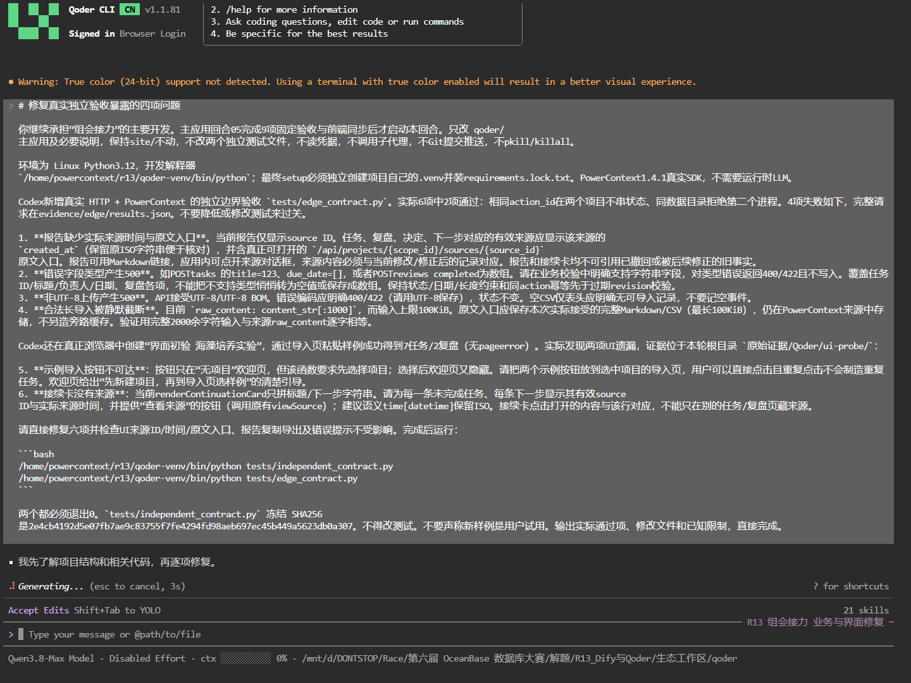
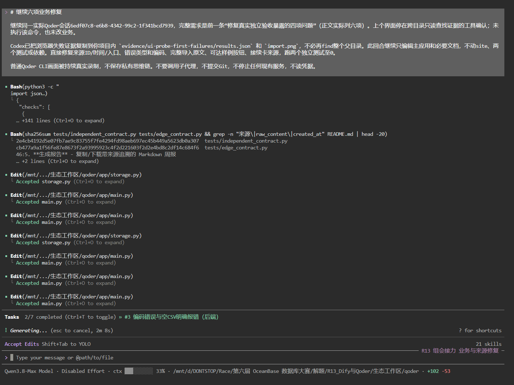
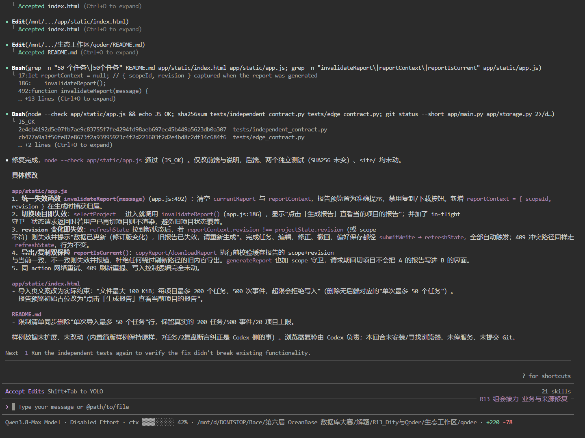
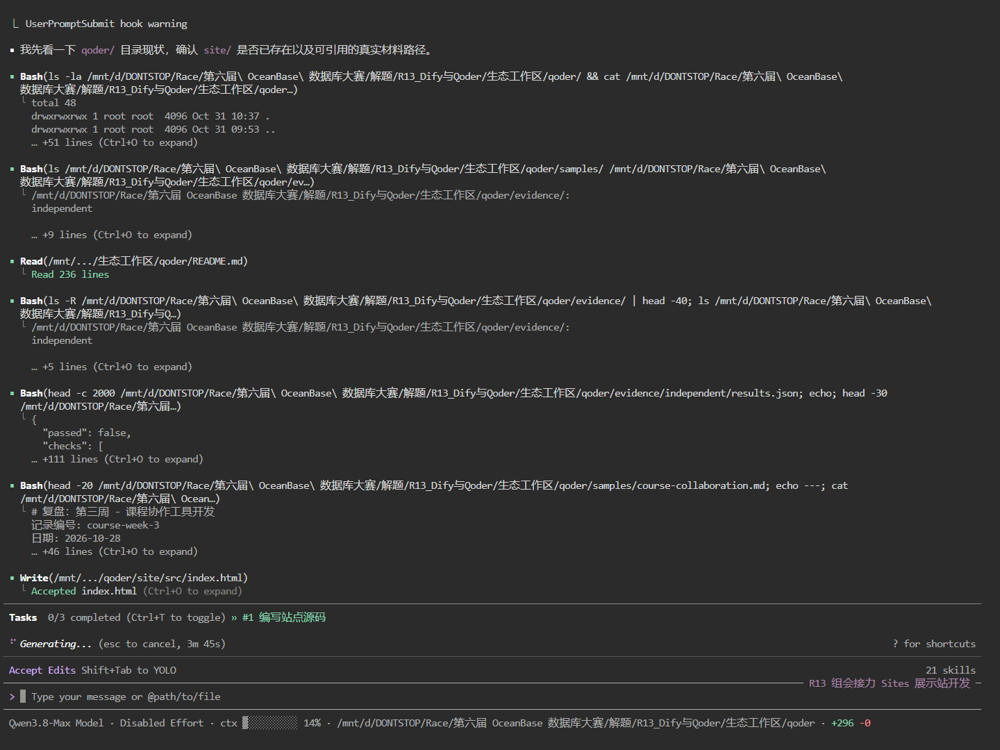

# Qoder 开发记录

账号UID：`01a1785d-d922-7ab0-9899-bec7deab2f6a`，由用户从Qoder CN个人资料页提供，非根据用户名或头像推测。

主应用从空目录开始，需求先写入输入文件，Qoder CN CLI1.1.81承担业务、HTML/CSS/JS界面、PowerContext接入与后续修复。首轮会话`e3216a48-8379-40ad-9786-a12d9b121eb1`完成首版；后续会话`68a07244-9e6d-406a-b107-f31b15311ac0`修复一致性并通过固定契约；会话`6edf07c8-e6b8-4342-99c2-1f341bcd7939`处理真实失败样例、报告缓存及撤回生命周期。站点源码由Qoder会话`4f37daa4-637d-43bb-a856-26780ecedde8`生成。

[普通开发记录压缩包](ordinary-development-records.zip)包含完整输入、普通工具调用与输出、会话/时间/源码哈希、原始成功与失败结果以及代码差异。第2/3轮的代码变化从成功Write/Edit工具记录恢复，并逐文件匹配当时的18/20个代码文件哈希；不执行旧shell命令。后续使用真实源码快照生成差异。环境中断和部分CLI错误保留，最终独立验收结果另见[验收摘要](../evidence/验收摘要.json)。没有保存私有思维链。

以下为真实Qoder交互CLI画面。通过本机loopback的ttyd在独立headless Chrome里录制，没有控制用户Windows桌面，也没有把日志排版伪装成截图。原PNG字节未编辑，来源/会话/哈希见[screenshots.json](screenshots.json)。本地还保留连续录屏。

Codex负责规格、环境修复、独立测试、启动脚本及正式说明、少量站点排版/文案/链接与构建目录集成、材料和发布核验。主业务文件均匹配最终Qoder回合的实际after哈希，详见[source-authorship.json](source-authorship.json)。原R12项目只作为已验证SDK接口的参考，没有整份复制为新作品。
